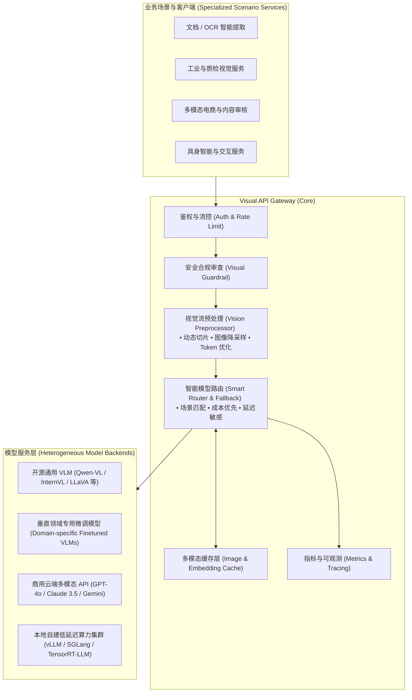

# Visual-API-Gateway 👁️⚡

STATIC：VLM Run Gateway 三轮研究归档见 [vlm-research/README.md](vlm-research/README.md)；导出范围、来源与离线复核限制见 [GitHub 导出说明](vlm-research/GITHUB-EXPORT.md)。

> **视觉语言模型（Vision-Language Models, VLM）高性能统一服务网关**  
> 专为下游垂直场景与专用视觉语言模型服务提供标准化接入、智能调度、多模态预处理及全链路治理能力。

---

## 📖 项目定位 (Overview)

随着多模态大模型的快速演进，不同细分场景（如复杂文档/OCR解析、工业质检、医疗影像理解、自动驾驶感知、电商多模态图文、具身智能等）对视觉语言模型提出了高度差异化的需求。

**Visual-API-Gateway** 定位于连接上层垂直场景业务与底层异构多模态模型的关键枢纽，通过提供统一的多模态 API 抽象与高性能网关代理能力，解决多模型接入复杂、图像传输与预处理开销大、算力负载不均及模型冷启动等核心痛点。

---

## 🌟 核心特性规划 (Key Features)

- 🌐 **统一多模态接入规范**
  - 提供兼容 OpenAI Vision 标准协议及扩展语义的统一 REST / gRPC 接口，让上层业务无需针对各个底层 VLM 重复适配。
- 🔀 **智能动态路由与故障转移 (Smart Routing & Fallback)**
  - 根据上游场景类型、图像分辨率、Token 预算、SLA 延迟及后端集群健康度，智能调度至最适配的模型实例；支持自动降级与熔断重试。
- ⚡ **高性能视觉预处理管线 (In-Flight Vision Pipeline)**
  - 内置图像格式转换、动态高分辨率切图分片、降采样与感知哈希去重，减少无效 Token 消耗并显著降低带宽与显存开销。
- 🗄️ **多模态语义与图像缓存 (Multimodal Caching)**
  - 支持原始图像指纹缓存与相似图像 Embedding 语义缓存，高频重复调用直接命中，降低推理成本并加速响应。
- 🛡️ **视觉安全与合规治理 (Visual Guardrails)**
  - 支持敏感图像识别、隐私脱敏（如人脸/车牌打码）、合规提示注入及输出风险拦截。
- 📊 **端到端多模态可观测性 (Full-Stack Observability)**
  - 精确统计 Vision Token、图像处理耗时、首包延迟 (TTFT)、推理吞吐量，支持 OpenTelemetry 链路追踪与 Prometheus 指标导出。

---

## 🎯 典型适用场景 (Use Cases)

| 场景服务 | 需求特点 | 网关赋予的能力 |
| :--- | :--- | :--- |
| **智能文档与合同解析** | 超长文本、高分辨率图表表格 | 自动切图分片、指定文档专用 VLM 优先路由 |
| **工业缺陷检测与质检** | 高并发、超低延迟、局域网部署 | 本地边缘算力负载均衡、健康检查与秒级故障转移 |
| **电商多模态图文生成** | 突发流量、成本敏感 | 高峰期智能降级、冷热模型自动调度、图像指纹缓存 |
| **全媒体内容安全审核** | 多格式输入、高实时性 | 统一前置预审过滤，拦截非法图像避免浪费算力 |

---

## 🗺️ 架构路线图 (Roadmap)

- [ ] **Phase 1: 基础框架与统一协议**
  - [ ] 定义统一多模态请求/响应规范（兼容 OpenAI Chat Completion Vision）
  - [ ] 实现反向代理引擎与基础负载均衡
  - [ ] 支持主流自建后端（vLLM、SGLang、Triton）与云端 API 接入
- [ ] **Phase 2: 视觉流水线与智能调度**
  - [ ] 视觉预处理管道（自适应分辨率缩放、裁剪、分片）
  - [ ] 图像指纹（pHash）与结果缓存机制
  - [ ] 基于场景与 SLA 的动态路由规则引擎
- [ ] **Phase 3: 企业级治理与可观测性**
  - [ ] Token / 图像调用粒度计费与限流
  - [ ] OpenTelemetry 链路追踪集成
  - [ ] 视觉敏感内容过滤与安全护栏 (Guardrails)

---

## 🤝 参与贡献 (Contributing)

项目正处于前期概念孵化与架构设计阶段，欢迎提交 Issue 探讨需求场景，或提交 PR 贡献核心模块！

---

## 📄 开源许可 (License)

本项目基于 [Apache 2.0](LICENSE) 协议开源。
