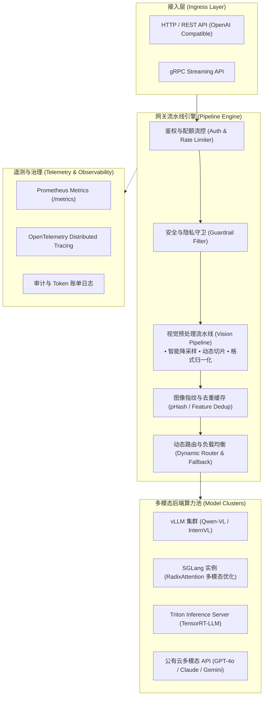

# Visual-API-Gateway 架构设计规范 (RFC 001)

本文档阐述 **Visual-API-Gateway** 的核心设计理念、分层架构、数据流转机制与扩展规范，作为后续工程实现（Go / Rust / Python）的蓝本。

---

## 1. 设计目标与挑战

### 1.1 核心痛点
1. **多模态数据体量巨大**：单张高分辨率图像或视频帧动辄数 MB，网络传输与解码造成显著网关压力。
2. **Vision Token 成本高昂**：未经剪裁、缩放或优化的图像，在多模态模型中会消耗成百上千个视觉 Token，导致延迟与推理算力成本成倍激增。
3. **垂直场景模型异构分散**：OCR、工业缺陷定位、医学影像、自动驾驶感知等场景通常采用不同专用微调模型，上游服务缺乏统一协议。
4. **长耗时与算力波动**：VLM 推理延迟较传统文本 LLM 显著增高，对熔断、智能分流、异步长轮询及缓存提出了严苛要求。

### 1.2 系统设计原则
- **零拷贝与流式预处理 (Zero-copy & Streaming)**：对视觉二进制流尽量减少内存复制，支持分块哈希计算与并行图像处理。
- **协议兼容性 (OpenAI-compatible & Extensible)**：全面兼容 OpenAI `/v1/chat/completions` 多模态输入标准，同时通过 Header 与扩展字段支持场景化参数（如 `X-VLM-Scenario: document_ocr`）。
- **细粒度多模态可观测性 (Multimodal Observability)**：除 HTTP 维度指标外，需追踪图像分辨率、通道数、预处理耗时、生成的 Vision Token 数量及显存占用画像。

---

## 2. 系统架构总览

---

## 3. 核心流水线阶段详解

### 3.1 视觉流处理 (Vision Pipeline)
- **自适应重缩放 (Adaptive Resizing)**：根据配置与目标模型的有效视野（FOV / Patch Size），将输入图像按最优网格进行缩放。
- **动态分片 (Dynamic Tiling)**：针对高清文档解析等场景，将超长图切割为规则局部切片加全局缩略图，并打包为标准模型输入格式。
- **感知哈希去重 (pHash Deduplication)**：对于视频流或高频连拍检测场景，比对连续帧的感知哈希汉明距离，若无显著变化直接复用前序结果，避免重复推理。

### 3.2 场景化智能路由 (Scenario-aware Routing)
1. **场景感知**：根据请求头部 `X-VLM-Scenario` 或路径前缀识别下游场景（如 `document_ocr`、`defect_detect`）。
2. **算力感知**：实时探测各 Backend 队列积压长度（Queue Depth）与显存利用率。
3. **回退降级 (Fallback)**：当主微调集群超时或发生 5xx 时，依据策略无缝将流量回退到公有云商业模型或兜底规则。

---

## 4. 后续开发规划

| 模块 | 规划实现目录 | 建议选型 |
| :--- | :--- | :--- |
| 网关主服务 | `cmd/gateway` / `src/` | Go / Rust (高性能低内存) 或 Python FastAPI (快速 PoC) |
| 视觉图像库 | `internal/vision` / `pkg/vision` | libvips / OpenCV / Pillow-SIMD |
| 路由与后端代理 | `internal/router` | 反向代理 / 动态连接池 |
| 缓存层 | `internal/cache` | Redis / Valkey / 内存 LRU |
