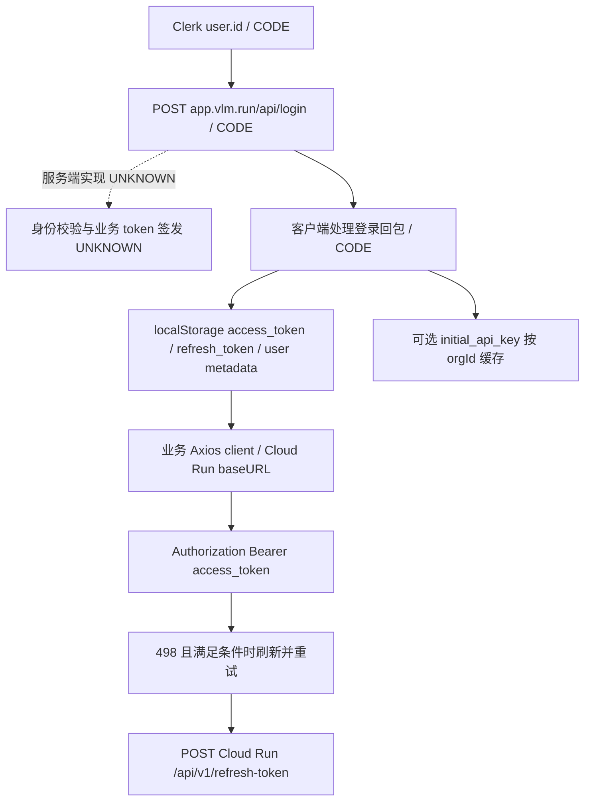

# 后端证据边界审计：Dashboard、Gateway 路由与会话

审计日期：2026-10-13。`STATIC`：本次只读取工作区已有文件，没有发起新 API 请求、登录、账单查询或执行下载代码；原始证据未修改。本文补充前两轮报告，不替换其历史结论。

分类：`SOURCE` 为发布者的文档/接口说明；`CODE` 为已保存代码直接表达的行为；`STATIC` 为本次离线分析结果；`RUNTIME` 为已有实际请求回包；`INFERENCE` 为推断；`PROPOSAL` 为建议；`UNKNOWN` 为证据不足。JS 行号均指格式化副本，线上 URL/原始资产信息在 [Dashboard/Gateway 资产索引](../research/frontend/assets.json) 和 [Chat 资产索引](../research/frontend/chat_embed.assets.json)。

## 1. 可以直接补齐的部分

|问题|本次可确定的结论|证据|
|---|---|---|
|Dashboard 如何开始业务登录|`CODE`：AuthProvider 取得 Clerk user 后，以 `user.id` 调登录 mutation；客户端实际发送同源 `POST /api/login`，JSON 字段为 `clerk_id`|[AuthProvider:525](../research/frontend/pretty/dashboard__4388-609d4193d71670a1.js:525)、[请求:398](../research/frontend/pretty/dashboard__4388-609d4193d71670a1.js:398)|
|是否已看到浏览器直接调用 `/api/v1/login/clerk-user`|`STATIC`：本次检查的共享客户端中，该片段出现在不加 access-token 的路径列表；当前登录请求函数是 `/api/login`。不能将列表中的字符串当作已执行调用|[豁免列表:317](../research/frontend/pretty/dashboard__27292-764f9b0d804e5d84.js:317)、[实际构造函数:398](../research/frontend/pretty/dashboard__4388-609d4193d71670a1.js:398)|
|首次 API Key 的浏览器路径|`CODE`：登录回包有 `initial_api_key` 时，以 `organization_id || org_id` 一同缓存；缓存 key 是 `vlm_onboarding_api_key`，读取时检查非空 key 和组织匹配|[回包处理:528](../research/frontend/pretty/dashboard__4388-609d4193d71670a1.js:528)、[缓存实现:440](../research/frontend/pretty/dashboard__27292-764f9b0d804e5d84.js:440)|
|并发请求触发刷新时怎样处理|`CODE`：共享变量保存刷新 Promise；已有 Promise 时复用，结束后清空。498 且未重试、存在 refresh token 时刷新并重试一次|[去重:477](../research/frontend/pretty/dashboard__27292-764f9b0d804e5d84.js:477)、[重试条件:361](../research/frontend/pretty/dashboard__27292-764f9b0d804e5d84.js:361)|
|历史消息是否只有一个读取入口|`CODE`：有同源 `/api/chat-messages/{sessionId}` 和 Agent `/chat/messages?session_id=...` 两条；`useCache` 未指定时，未持有 access token 的分支默认选择前者|[分支:1120](../research/frontend/chat_pretty/chat__47156-78eb08e3d3098fe8.js:1120)、[同源读取:1126](../research/frontend/chat_pretty/chat__47156-78eb08e3d3098fe8.js:1126)、[直读:1159](../research/frontend/chat_pretty/chat__47156-78eb08e3d3098fe8.js:1159)|
|空白历史是否证明没有保存|`CODE`：两条读取路径均把 401/403 转为空 `messages` 和本地当前时间；展示转换还过滤 `role=tool` 与部分反馈文本。`INFERENCE`：只观察界面空白或缺少工具消息，无法判断后端是否保存|[缓存分支:1144](../research/frontend/chat_pretty/chat__47156-78eb08e3d3098fe8.js:1144)、[直读分支:1180](../research/frontend/chat_pretty/chat__47156-78eb08e3d3098fe8.js:1180)、[展示过滤:1195](../research/frontend/chat_pretty/chat__47156-78eb08e3d3098fe8.js:1195)|
|是否能从公开合同补充 router 的具体职责|`SOURCE`：embedding router 先把输入标准化成 item 列表；响应合同说明 provider 按请求报告、同 model ID 可选不同 upstream；结构化 OCR/detection 的 JSON envelope 由 Gateway 构造|[embedding 合同:1557](../research/round2/captures/gateway_openapi.response.json:1557)、[响应字段说明:843](../research/round2/captures/gateway_openapi.response.json:843)、[序列化说明:2169](../research/round2/captures/gateway_openapi.response.json:2169)|

这些项目从“细节未整理”变成有锚点的客户端代码或公开合同；没有因此取得相应服务端函数。

## 2. Dashboard 登录、API Key 与账单

### 2.1 已知路径与断点

以下仅画 `CODE` 已知客户端路径。虚线后的部分是 `UNKNOWN`，不是推断的转发链。

|阶段|类别与事实|锚点|仍未由此确定|
|---|---|---|---|
|未登录 Dashboard 访问|`RUNTIME`：2026-10-11 抓取 `https://app.vlm.run/dashboard` 后最终 URL 为 `/sign-in?redirect_url=%2Fdashboard`，最终响应 200；headers 包含 `X-Clerk-Auth-Status: signed-out`|[抓取元数据:2](../research/runtime/dashboard.meta.json:2)|完整跳转链、登录后页面实际回包、当前登录状态|
|前端身份源|`CODE`：AuthProvider 使用 Clerk user/isSignedIn/isLoaded 与自有 `isBackendAuthenticated` 状态|[AuthProvider:474](../research/frontend/pretty/dashboard__4388-609d4193d71670a1.js:474)|Clerk session 在 `/api/login` 的实际验证函数、JWT 验证参数|
|业务登录交换|`CODE`：同源 `POST /api/login {clerk_id}`；另有 Cloud Run `POST /api/v1/login/account-exists {email}` 客户端函数|[login:394](../research/frontend/pretty/dashboard__4388-609d4193d71670a1.js:394)、[account-exists:416](../research/frontend/pretty/dashboard__4388-609d4193d71670a1.js:416)|同源 handler 是否转发、转发至何处、内部签名与数据库事务；本轮没有调用这些接口|
|业务客户端地址|`CODE`：Axios baseURL 固定为 `https://prod-vlm-cloud-nfsnfpr33q-uc.a.run.app`|[baseURL:304](../research/frontend/pretty/dashboard__27292-764f9b0d804e5d84.js:304)|整个产品均托管于此地址、该服务背后的数据库/队列/副本|
|业务 Bearer|`CODE`：取 `localStorage.access_token`；除登录片段和刷新片段匹配的路径外，加 `Authorization: Bearer ...`|[拦截器:314](../research/frontend/pretty/dashboard__27292-764f9b0d804e5d84.js:314)|该 token 的编码、服务端有效期、撤销和轮换策略；不能将此 token 与用户 API Key 当成同一种凭证|
|刷新实现|`CODE`：向上述 Cloud Run 根发送 `/api/v1/refresh-token {refresh_token}`；成功复用登录结果保存函数；失败清除本地值并去 `/logout`|[刷新请求:488](../research/frontend/pretty/dashboard__27292-764f9b0d804e5d84.js:488)、[保存:432](../research/frontend/pretty/dashboard__27292-764f9b0d804e5d84.js:432)|服务端是否旋转 refresh token、旧 token 是否失效、跨设备规则|
|初始 API Key|`CODE`：可选回包字段与组织 ID 存在客户端分支；登录保存函数同时移除旧 `api_key` 项|[登录回包:528](../research/frontend/pretty/dashboard__4388-609d4193d71670a1.js:528)、[保存/缓存:432](../research/frontend/pretty/dashboard__27292-764f9b0d804e5d84.js:432)|生产是否为每个新用户产生 key、生成算法、哈希算法、后端存储、可见次数与撤销实现|
|Key 设置功能|`SOURCE`：Settings 文档说明 revoke、按 key 查看用量；同文第 11 行把“为不同用户和项目创建新 key”标为 coming soon，而导航说明含 create|[功能说明:9](../research/docs/docs.vlm.run__platform__settings.md:9)、[导航文案:58](../research/docs/docs.vlm.run__platform__settings.md:58)|多 key 创建是否已经上线；文档内部范围/状态不能自行消解|
|账单界面|`SOURCE`：文档说明计划、余额、消费趋势、充值和发票；前端 layout 中有 billing 导航|[文档:31](../research/docs/docs.vlm.run__platform__settings.md:31)、[导航:849](../research/frontend/pretty/dashboard__layout-60a5c64292d87762.js:849)|业务计费 API、支付处理商、发票系统、扣费事务、Webhook、账本表结构|

`STATIC`：已保存 Dashboard 的 `dashboard__54353-37fb4b1196377504.js` 含通用 Clerk React 库（[packageName:188](../research/frontend/pretty/dashboard__54353-37fb4b1196377504.js:188)）及该库的 billing resource 字符串（[billing-payment-attempts:5092](../research/frontend/pretty/dashboard__54353-37fb4b1196377504.js:5092)）。这只确定下载 bundle 含相关库代码，不能证明 VLM Run 业务账单使用 Clerk Billing、Stripe 或某种数据库。

`SOURCE`：Gateway 鉴权文档说明，无 header 是匿名、有效 VLM Run key 对应用户与组织、其他 bearer 返回 401；key 查询不可用时返回 503；组织余额用尽为 402，frontier 模型需要 paid tier。锚点：[查询失败:63](../research/docs/docs.vlm.run__gateway__authentication.md:63)、[分层:74](../research/docs/docs.vlm.run__gateway__authentication.md:74)、[credits:85](../research/docs/docs.vlm.run__gateway__authentication.md:85)。这些是公开行为合同，未公开 lookup 函数和后端数据结构。

`RUNTIME`：第一轮 Gemini 请求得到 403 `model_not_entitled`，消息要求为组织增加付款方式，见 [请求模型:6](../research/runtime/probe_provider.request.json:6)、[HTTP 状态:6](../research/runtime/probe_provider.meta.json:6)、[回包:3](../research/runtime/probe_provider.response.json:3)。这确认该请求的 entitlement 拒绝，未执行成功的上游推理；不能据此写出 provider 请求体或真实扣费。

## 3. Gateway router / provider adapter

|层|当前可确认的内容|来源|边界|
|---|---|---|---|
|Python SDK|`CODE`：Gateway resource 以 OpenAI SDK 指向 `{base_url}/openai`，透传 API Key、timeout 与 max_retries；client.timeout 为默认 120 时 Gateway 调整为 600|[gateway.py:57](../research/code/vlmrun-python-sdk/vlmrun/client/gateway.py:57)、[构造:79](../research/code/vlmrun-python-sdk/vlmrun/client/gateway.py:79)|这是客户端包装，不是 router；600 秒不是已确认的服务端超时|
|浏览器 Gateway 入口|`CODE`：base 为同源 `/api/gateway`；构造 `/openai/chat/completions`；Gateway 分支的 Bearer 取显式 gatewayBearerToken 或字面量 `vlmrun`|[base:140](../research/frontend/chat_pretty/chat__47156-78eb08e3d3098fe8.js:140)、[请求:878](../research/frontend/chat_pretty/chat__47156-78eb08e3d3098fe8.js:878)|同源代理是否移除/替换此 header、如何选 upstream，UNKNOWN。文档所说任意无效 bearer 返回401，不能直接外推到同源代理的内部实现|
|公开部署结构说明|`SOURCE`：官网说单 router 后有五种 runtime、模型为隔离 plugin、常驻；PDF 按页并行、失败页重试或标记、统一输出|[官网说明:52](../research/docs/vlm.run__blog__introducing-gateway.raw.txt:52)|没有 router 类、plugin 装载器、进程边界或 worker 调度代码|
|输入标准化|`SOURCE`：embedding 输入在 router 处归一成列表，后端只接一种形状|[OpenAPI:1557](../research/round2/captures/gateway_openapi.response.json:1557)|归一函数的具体分支、tokenizer 调用和参数尚无源码|
|响应审计字段|`SOURCE`：`served_model_id` 是部署 canonical ID；`backend` 是 runtime 标签；`provider` 逐请求报告，并非承诺与目录一致|[OpenAPI:843](../research/round2/captures/gateway_openapi.response.json:843)|字段是 API 回报，不是完整内部 trace；不能从 provider=null 推导精确机器、地区或部署产品|
|OCR method 路由|`SOURCE`：目录说明 ocr→PP-OCRv6，markdown→CPU parser/出错时 dots.mocr，layout→dots.mocr|[目录:1405](../research/round2/captures/gateway_models.response.json:1405)|CPU 条件判断和 fallback 捕获范围尚缺源码|
|实际 OCR 输出路径|`RUNTIME`：ocr 回包 `paddleocr/pp-ocrv6` / `paddleocr`；layout 为 `dots.mocr` / `vllm`；原生 PDF markdown 为 `xberg`|[ocr:5](../research/round2/captures/ocr_auto_ocr.response.json:5)、[layout:5](../research/round2/captures/ocr_auto_layout.response.json:5)、[PDF:5](../research/round2/captures/ocr_auto_markdown_native_pdf.response.json:5)|这三次路由输出已观察；图片 markdown 是否先尝试 CPU 后失败仍 UNKNOWN|
|JSON 输出与能力拒绝|`SOURCE`：OCR/detection envelope 由 Gateway 构造；非适用模型的 json_schema 返回 capability violation|[OpenAPI:2169](../research/round2/captures/gateway_openapi.response.json:2169)|各 adapter 的 parse/normalize/schema-constrain 实现和生产 prompt 不在合同中|
|限流存储|`SOURCE`：默认 counter 在 serving process，配置 `VLMRT_RATE_LIMIT_STORAGE_URI` 才用 shared storage；无 shared storage 时有效额度随副本增长|[文档:51](../research/docs/docs.vlm.run__gateway__rate-limits.md:51)|生产该变量的值、是否启用以及存储产品均 UNKNOWN；不能改写成“已确认使用 Redis”|

`STATIC`：公开 OpenAPI 中 `vlmrt__chat__types__Usage` 等名字可定位类型命名空间，见 [OpenAPI:829](../research/round2/captures/gateway_openapi.response.json:829)；它不包含相应 Python 实现。此前保存的 GitHub 仓库搜索回包 `total_count=0`（[回包:2](../research/round2/captures/github_vlmrt_search.response.json:2)）、PyPI `vlmrt` 请求 404（[meta:6](../research/round2/captures/pypi_vlmrt.meta.json:6)），限定为那些查询和时间点的结果，不证明源码永远无法取得。

`UNKNOWN`：目前没有可对应 `0.47.1` 部署的 router/adapter 源码、镜像 SBOM、依赖锁、provider 出站 trace、路由配置、系统 prompt 组装函数。公开 SDK、xberg/mm 源码和上游模型模板各自只能说明相应公开项目，不能填入这些缺口。

## 4. Session：创建、回读、展示与持久化

### 4.1 可逐步追踪的客户端路径

|步骤|类别与行为|锚点|
|---|---|---|
|选择 Agent root|`CODE`：默认 `https://agent.vlm.run/v1`；本地 active/saved agent 配置可覆盖；将所选 base URL 写入 `agent_api_base_url` cookie|[base 选择:84](../research/frontend/chat_pretty/chat__47156-78eb08e3d3098fe8.js:84)|
|生成 session token|`CODE`：32 个随机字节，`crypto.getRandomValues`，base64url；保存于 `localStorage.st_{sessionId}`|[生成/保存:1456](../research/frontend/chat_pretty/chat__47156-78eb08e3d3098fe8.js:1456)|
|构造聊天请求|`CODE`：请求含 `session_id`，可选 `session_token`，stream/preview 为 true；默认 model 为 `vlmrun-orion-2:auto`|[请求构造:809](../research/frontend/chat_pretty/chat__47156-78eb08e3d3098fe8.js:809)、[session 参数:839](../research/frontend/chat_pretty/chat__47156-78eb08e3d3098fe8.js:839)|
|匿名 Agent 的附加信息|`CODE`：没有 access token 且不是 Gateway 时，获取 fingerprint 和 playground ticket；分别加 `X-Browser-Fingerprint` 与 `X-VLM-Playground-Ticket`|[fingerprint:674](../research/frontend/chat_pretty/chat__47156-78eb08e3d3098fe8.js:674)、[ticket:690](../research/frontend/chat_pretty/chat__47156-78eb08e3d3098fe8.js:690)、[选择条件/headers:878](../research/frontend/chat_pretty/chat__47156-78eb08e3d3098fe8.js:878)|
|回读 session|`CODE`：两条读取路径都从 `st_{id}` 取值并加 `X-Session-Token`；回包有 `media_token` 时写回相同本地项|[同源:1126](../research/frontend/chat_pretty/chat__47156-78eb08e3d3098fe8.js:1126)、[直读:1159](../research/frontend/chat_pretty/chat__47156-78eb08e3d3098fe8.js:1159)|
|显示消息|`CODE`：过滤 role=tool 及以 Validation feedback/Fix the errors 开头的文本；401/403 已在读取层转空消息|[过滤条件:702](../research/frontend/chat_pretty/chat__47156-78eb08e3d3098fe8.js:702)、[转换:1195](../research/frontend/chat_pretty/chat__47156-78eb08e3d3098fe8.js:1195)|

`STATIC`：token 生成函数与 `media_token` 回写使用同一存储函数；这不足以证明服务端两类 token 恒等、等权或能永久互换。这里只记录客户端实际保存和读取路径。

### 4.2 会话管理不等于消息存储实现

`CODE`：Chat 所用共享 Axios 模块也以同一 Cloud Run URL 为根，见 [chat 共享客户端:305](../research/frontend/chat_pretty/chat__27292-c4c05ae0e224d68a.js:305)。下表是该浏览器代码的业务路径，未在本次离线审计执行：

|方法与路径|代码中请求/处理|锚点|
|---|---|---|
|GET `/api/v1/chat-history`|skip 默认0、limit 默认20；去除 pinned 后的计数用于本地 hasMore 判断|[列表:1034](../research/frontend/chat_pretty/chat__47156-78eb08e3d3098fe8.js:1034)|
|GET `/api/v1/chat-history/{id}`|读取 credit_cost、cost_dollars、model_id、model_version、source、messages_count、时间、status、completion_metadata|[metadata:1057](../research/frontend/chat_pretty/chat__47156-78eb08e3d3098fe8.js:1057)|
|PATCH `/api/v1/chat-history/{id}/pin`|body `is_pinned`|[pin:1077](../research/frontend/chat_pretty/chat__47156-78eb08e3d3098fe8.js:1077)|
|PATCH `/api/v1/chat-history/{id}/rename`|body `title`|[rename:1086](../research/frontend/chat_pretty/chat__47156-78eb08e3d3098fe8.js:1086)|
|PATCH `/api/v1/chat-history/{id}/share`|body `is_public`；改为非 public 时另调用同源 purge-cache|[share:1095](../research/frontend/chat_pretty/chat__47156-78eb08e3d3098fe8.js:1095)|
|POST 同源 `/api/purge-cache`|body `sessionId`；客户端 catch 不向上抛出|[purge:1104](../research/frontend/chat_pretty/chat__47156-78eb08e3d3098fe8.js:1104)|
|DELETE `/api/v1/chat-history/{id}`|客户端删除调用|[delete:1117](../research/frontend/chat_pretty/chat__47156-78eb08e3d3098fe8.js:1117)|

`UNKNOWN`：这些 metadata 路径与 Agent 消息读取路径是否访问同一数据库，记录怎样关联，缓存在哪一层，以及删除/取消分享后的传播时延。`/api/purge-cache` 这个函数名和请求只说明客户端意图，不证明缓存产品、删除成功或立即失效。

### 4.3 已有运行证据与合同差异

`SOURCE`：Agent OpenAPI 说明 `session_id` 用于持久保存历史，session token 由客户端生成；history 说明 authenticated 用户可访问 own/public chats，token-bearing sessions 在 **non-owner** 访问时需要匹配 token，见 [session 字段:2626](../research/runtime/api_openapi.json:2626)、[history 说明:290](../research/runtime/api_openapi.json:290)。

`RUNTIME`：第二轮显式 session 的回读获得 200，响应含五条消息及创建/更新时间；相同 session 的另一次回读获得 403 `You do not have access to this chat.`。锚点：[200 meta:6](../research/round2/captures/orion_hash_history.meta.json:6)、[历史:2](../research/round2/captures/orion_hash_history.response.json:2)、[403 meta:6](../research/round2/captures/orion_history_owner_without_session_token.meta.json:6)、[403 body:2](../research/round2/captures/orion_history_owner_without_session_token.response.json:2)。

`CODE`：带 token 回读的采集调用显式设置 `X-Session-Token`，见 [采集工具:211](../tools/investigate_round2.py:211)。`STATIC`：两个保存的 request JSON 都只含 URL/method/auth/body，未单独归档附加 headers，见 [200 对应 request:1](../research/round2/captures/orion_hash_history.request.json:1)、[403 对应 request:1](../research/round2/captures/orion_history_owner_without_session_token.request.json:1)。因此 200/403 可直接从回包和元数据复核；精确 header 差异的复核还依赖采集代码及第二轮运行记录，不能声称仅凭两个 request 文件就完整复现了 HTTP 请求头。

`UNKNOWN`：为何相同 API Key 的另一请求仍被视为不可访问，服务端 owner 如何判定，session 是归属用户、组织还是 guest，均缺少服务端会话 metadata/逻辑。文件名中的 `owner_without_session_token` 不是 owner 身份的独立证据。不能把一次 403 扩写成“所有 owner 读取都需要 token”，也不能未经取证把公开合同判为错误。

`RUNTIME`：第一轮不同实验曾为 404，仍见 [旧结果:2](../research/runtime/probe_orion2_history.response.json:2)。`UNKNOWN`：旧失败与第二轮成功之间同时改变了 session 创建方式、token、preview 与任务；不能把旧失败单一归因于缺 token。

`UNKNOWN`：一次成功回读没有覆盖跨进程重启、跨副本、跨区域、TTL 到期、删除后读取、长期恢复。`created_at/updated_at` 是 API 返回字段，不是数据库产品或持久化事务证据。

## 5. 尚缺少的具体材料

下表中的“所缺材料”用于精确定义 UNKNOWN 的关闭条件，不表示这些材料已存在于本地或已执行查询。

|UNKNOWN 项|证据当前止于何处|所缺材料|
|---|---|---|
|Dashboard `/api/login` 服务端|浏览器同源请求与回包处理函数|对应部署的 Next.js handler/源码或入口到签发的 trace|
|access/refresh token 签发与失效|客户端保存、498 刷新、单飞重试|签发/验证函数、生产配置、token 生命周期运行记录|
|API Key 生成/验证/撤销/轮换|初始 key 的浏览器缓存，鉴权文档与 entitlement 回包|Key 服务源码、存储 schema/迁移、验证调用链、已执行的轮换/撤销记录|
|账单 ledger 与支付系统|界面文档、费用字段、拒绝消息|业务账单 API/handler、账户实际明细、usage→ledger→invoice 的关联记录|
|Gateway router 与 adapters|公开接口、官网结构说明、三条实际 OCR 路由输出|部署对应 router/adapter 源码、依赖锁/SBOM、内部调用 trace|
|provider 的请求体/选择/计费拆分|目录 provider 字段及逐请求响应合同|出站请求与响应 trace、路由选择记录、逐步骤 usage/账目|
|限流共享存储与副本|默认进程内 counter 的文档|生产 URI 配置与后端类型、部署副本配置、相应计数观测|
|ticket/fingerprint 服务端|POST ticket、客户端 visitorId 缓存、headers|ticket mint/verify handler、字段/过期定义、服务端使用 fingerprint 的调用链|
|历史数据库与 owner 判定|客户端 metadata/message 两套入口及一次 200/403|表/集合与关联、owner 判定函数、创建时身份归属记录|
|会话 TTL/跨重启持久性|一次有限时点回读成功|保存/清理配置、重启前后与到期边界的已执行记录|
|历史缓存与 purge|同源 cache 读取及 purge 请求代码|route handler、缓存 key/TTL/失效实现与命中/失效日志|

`PROPOSAL`：后续正常采集时为请求记录增加附加 header 的名称和脱敏值，并保留采集脚本版本/hash。这能使“是否携带 session token”本身成为可独立复核的证据，而无需修改任何历史原始文件。

## 6. 本次审计核对范围

`STATIC`：本文逐项对照本地 JS、SDK、文档、OpenAPI 和已有回包；所有列出的客户端 API 路径都附代码锚点，公开合同与运行观察分开。没有新增“登录成功”“账单核对完成”“生产源码已取得”或“会话跨重启持久”的完成声明。

`STATIC`：本文对旧报告只作补充：登录实际客户端入口、首次 key 缓存、刷新 Promise 去重、历史缓存分支和展示过滤均来自已保存代码；精确 header 归档缺口与 owner 语义未确定也显式保留，未静默改动旧报告。
