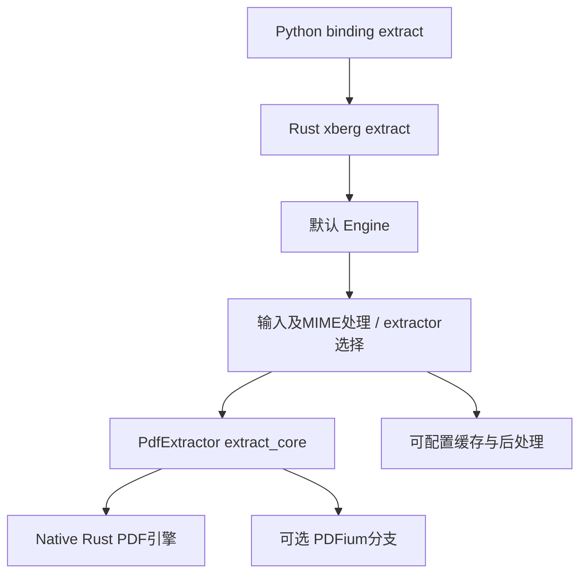

# UNKNOWN 第二轮调查：2026-10-13

本轮在第一轮证据基础上继续查询公开协议、官方发行包和上游模型代码，并执行小规模API验证。第一轮采集为10月11日；本轮为10月13日，两轮快照不相互覆盖。证据分类沿用 SOURCE / CODE / STATIC / RUNTIME / INFERENCE / UNKNOWN。

新增证据位于 `research/round2/`。导航：[本轮请求记录](round2-runtime.md)、[26项模型快照](models_2026-10-13.md)、[上游提示词及完整模板](upstream-prompts.md)、[原始数据汇总](round2-runtime-summary.json)、[证据哈希清单](round2-evidence-manifest.json)。

## 1. 本轮可以确立的新增结论

|原先未知点|本轮实际得到的证据|结论范围|
|---|---|---|
|OCR Auto的CPU后端名称|RUNTIME：原生文本PDF的markdown回包报告`backend=xberg`，内容正确、token与cost均为0|名称已确认；具体版本、配置及私有adapter仍UNKNOWN|
|OCR Auto方法路由是否实际发生|RUNTIME：ocr→PP-OCRv6/paddleocr；layout→dots.mocr/vllm；图片markdown→dots.mocr/vllm|四个输入/方法组合已执行；图片请求是否先尝试CPU分支并报错，缺少内部trace|
|System One WebSocket能否工作|RUNTIME：session.created→decision→session.stats，1帧、0错误、0丢帧|该单帧路径成功；并发、丢帧边界和持续性能未测试|
|MCP prompts/resources内容|RUNTIME：三个list方法均成功，列表均为空|此凭证、此时间点没有列出的prompt/resource/template；不能推导系统内没有提示词|
|OAuth是否仅文档声明|RUNTIME：公开discovery返回issuer、端点、scope和S256配置|配置发布已验证；登录、token兑换和存储实现未运行验证|
|DiffusionGemma JSON模式冲突|RUNTIME：json_object请求400 capability_violation|实际拒绝该请求；同日list=false/detail=true的元数据冲突仍存在|
|Orion能否完成非平凡计算|RUNTIME+STATIC：随机输入SHA-256输出与本地hashlib一致；三次execute_code调用、两条Retrying反馈|正确计算及反馈可见；独立tool-result、进程退出码与沙箱实现仍未取得|
|Orion会话能否回读|RUNTIME：显式session_id/session_token后回读200；同API Key省略token回读403|这条token绑定会话可读取；旧404的根因、跨重启持久性与存储产品仍UNKNOWN|
|模型上游chat template和任务prompt|CODE：取得Qwen/DiffusionGemma/dots模板、dots 8个任务prompt|上游原文可见；生产实际拼接全文和覆盖参数仍UNKNOWN|

## 2. 服务版本和模型目录已经变化

RUNTIME：[本轮health](../research/round2/captures/gateway_health.response.json)为`0.47.1`，commit `9cd50bb9486caf8f54332b79702f772a819e9371`，部署标记`26-10-12`。第一轮`0.46.1`是旧快照，未被新回包否定。

STATIC比较两个实际目录：24项增至26项，没有删除旧ID，新增：

- `google/embeddinggemma-2`：目录描述为共享768维空间，可截为512/256/128；输入能力字段还列出audio/document/file，而description只列text/image/video，不能单凭元数据断言全部模态实测可用。
- `lightonai/lightonocr-3-4b`：目录方法为markdown、grounding、layout。它不是旧官网coming-soon的`lightonai/lightonocr-1b-1025`，不能按同名系列替换成同一个模型。

RUNTIME来源：[目录回包](../research/round2/captures/gateway_models.response.json)。两项新模型本轮未执行推理。Agent OpenAPI的ChatCompletionsRequest与旧版本相同、路径集合相同，为STATIC比较，不表示所有服务端实现未变。

## 3. OCR Auto：从未知CPU解析器到可定位的上游项目

### 3.1 实际路由

|输入与method|回包model / backend|内容与成本|证据|
|---|---|---|---|
|合成图片，ocr|paddleocr/pp-ocrv6 / paddleocr|三行文本、坐标；usage.cost=0.001|[回包](../research/round2/captures/ocr_auto_ocr.response.json)|
|原生文本PDF，markdown|vlm-run/ocr:auto / xberg|`ROUND2 INVOICE NATIVE-013 Total USD 17.25`；token=0、cost=0|[回包](../research/round2/captures/ocr_auto_markdown_native_pdf.response.json)|
|合成图片，layout|rednote-hilab/dots.mocr / vllm|doc.page.blocks，三块文本；cost=0.001|[回包](../research/round2/captures/ocr_auto_layout.response.json)|
|合成图片，markdown|rednote-hilab/dots.mocr / vllm|三行Markdown；cost=0.001|[回包](../research/round2/captures/ocr_auto_markdown_image.response.json)|

以上均为RUNTIME。原生PDF由本地脚本生成，含Helvetica文本流，文件为[测试PDF](../research/round2/native_text.pdf)。SOURCE：此前目录声明markdown走CPU parser、错误时dots.mocr；INFERENCE：图片markdown观察与回退描述相容，但不能确认CPU是否实际先执行、为何选择dots。

### 3.2 xberg公开代码中的真实路径

RUNTIME：PyPI名称`xberg`返回发行版1.3.8及项目链接[github.com/xberg-io/xberg](https://github.com/xberg-io/xberg)，见[包元数据](../research/round2/captures/pypi_xberg.response.json)。本地保存源码commit `ccf03a3d1979b7923f447b96decbbdab655178c9`，其Cargo版本为1.3.9。**这两个版本均不是已确认的Gateway部署版本。**

CODE：公开项目的调用结构如下，箭头描述这个固定commit的代码，不是捕获的Gateway栈：



- CODE：[Python binding](../research/round2/code/xberg/crates/xberg-py/src/lib.rs:30867)将Python输入和配置转换后调用`xberg::extract`；[Rust入口](../research/round2/code/xberg/crates/xberg/src/core/extract/mod.rs:23)委托给默认Engine。
- CODE：[extract_file](../research/round2/code/xberg/crates/xberg/src/core/extractor/file.rs:167)探测MIME并进入extractor；[缓存分支](../research/round2/code/xberg/crates/xberg/src/core/extractor/file.rs:284)在启用时组合文件BLAKE3与配置hash作为key，并检查TTL、namespace和插件版本状态。这只确定此上游分支的缓存设计。
- CODE：[PdfBackend](../research/round2/code/xberg/crates/xberg/src/core/config/pdf.rs:17)默认Native，也提供Pdfium；[extract_core](../research/round2/code/xberg/crates/xberg/src/extractors/pdf/mod.rs:1966)按配置分派。不能因为项目含PDFium就认定VLM Run用了PDFium。
- INFERENCE：回包backend名称、CPU文档处理用途与PyPI项目吻合，使该项目成为具体可研究的候选组件。UNKNOWN：Gateway是否加载这个包、哪个版本/feature/config、如何包成adapter，仍缺乏依赖锁或调用trace。

另有官方公开[mm项目](https://github.com/vlm-run/mm)，固定commit `465b31ca6de9858b061c6ad9126164908d2e408f`。CODE：[pdf.py](../research/round2/code/mm/python/mm/pdf.py:148)使用pypdfium2；[store/db.py](../research/round2/code/mm/python/mm/store/db.py:1)为SQLite+sqlite-vec。**这些是mm客户端项目的实现，不能据此把Gateway数据库写成SQLite。**

## 4. Orion：计算、重试、会话的可观测闭环

### 4.1 随机SHA-256验证

本地生成随机字符串，发送普通计算任务；服务端请求不包含预先算好的摘要。使用公开execute_code能力，不访问网络、媒体或文件。参数包含`stream=true`、`preview=true`、`expose_server_tool_calls=true`、显式session_id和新生成的session_token。凭证和token在归档中已替换。

RUNTIME：[SSE原始流](../research/round2/captures/orion_hash.response.raw)包含1263个JSON事件，3个execute_code调用起始；同一调用的增量仍出现先`{}`再实际参数的序列。两条可见Retrying反馈为：

1. import阶段称`hashlib`不允许，列出`asyncio/datetime/json/math/pathlib/re/sys/typing`，并提示通过ctx.import_lib加载代理库。
2. execute阶段出现`CodeExecutionRuntimeError: NameError: unknown function 'bytearray'`，消息称只提供ctx/cv2/vlmrun/ffmpeg/NumpyImageRef代理的方法。

RUNTIME：流的content中出现`ROUND2_SHA256=...`和最终摘要。STATIC：[本地核对](../research/round2/hash_check.json)显示它与本地hashlib计算完全一致，输入与预期值见[计算输入](../research/round2/hash_challenge.json)。两条反馈原文和统计见[汇总](round2-runtime-summary.json)。

INFERENCE：随机长串的正确SHA-256、错误反馈和三次代码改写共同强烈支持本次路径进行了程序计算；比上一轮`1²+...+5²=55`提供了更强证据。但RUNTIME事件仍只有content/role/tool_calls，没有独立role=tool结果或进程日志，不能把assistant的“execution succeeded”当成沙箱证明或底层虚拟化证据。UNKNOWN：是自定义解释器、受限执行器、容器还是其他执行设施。

RUNTIME：本次完整HTTP读取约139.96秒；usage报告prompt_tokens=111524、completion_tokens=8620、reasoning_tokens=3488、cost_dollars=0.055007。请求max_tokens=2048不能直接拿来推定总harness token上限；总量如何分配至三次调用UNKNOWN。

### 4.2 会话回读已经成功，旧404仍保留

RUNTIME：同一新会话，API Key加`X-Session-Token`回读200；相同API Key省略此header回读403，`You do not have access to this chat.`。回读有5条消息：user、4条assistant；3条assistant带tool_calls，未含role=tool。回包media_token已脱敏。

证据：[带token回读](../research/round2/captures/orion_hash_history.response.json)、[不带token回读](../research/round2/captures/orion_history_owner_without_session_token.response.json)、[请求schema](../research/round2/captures/agent_openapi.response.json)。本次客户端先自己设置session_id，不是依赖服务器临时生成ID；和旧实验相比还改变了preview、任务等参数，所以**不能把旧404单一归因于缺token**。

CODE：浏览器[生成32随机字节并base64url编码](../research/frontend/chat_pretty/chat__47156-78eb08e3d3098fe8.js:1456)，存入localStorage的`st_<sessionId>`；[GET history](../research/frontend/chat_pretty/chat__47156-78eb08e3d3098fe8.js:1123)携带`X-Session-Token`。公开客户端的行为与本次回读结果吻合。数据库产品、保存期限、重启后的历史恢复仍UNKNOWN。

### 4.3 前端怎样显示运行状态

CODE：[SSE消费](../research/frontend/chat_pretty/chat__47156-78eb08e3d3098fe8.js:931)累积content，扫描Retrying、Validation feedback、Fix the errors等文本；[匹配规则](../research/frontend/chat_pretty/chat__47156-78eb08e3d3098fe8.js:671)就在客户端。它不是通过独立execution-result事件证明每一步成功。

CODE：同一文件可见preview解析和渲染对象定义。RUNTIME：本次流末尾有preview.suggestions。UNKNOWN：preview源数据由哪个私有执行函数产生、哪些模型负责建议及每个服务端工具的完整实现。

## 5. System One WebSocket：由未验证转为单帧成功

RUNTIME：[完整记录](../research/round2/websocket.json)通过websocket-client并使用本机已配置HTTP代理，完成：

```text
session.create
→ session.created：max_inflight=1，max_frame_bytes=2097152，canvas_widths=[16]
→ 发送一张合成PNG的原始字节
→ decision：invoice.noul=0.9323294820420261，reads=1，cost=0.001
→ session.close
→ session.stats：frames=1，decisions=1，dropped=0，errors=0
```

RUNTIME：服务端latency_ms报告73.283609，本地完整会话约1.968秒。单帧stats的p50/p95都等于该帧延迟，不构成性能分位数基准。session.created还报告max_cost=5.0、expires_in=600；这不是本次消费5美元，实际decision与stats均为0.001。

INFERENCE：上一轮旧websockets客户端未显式走本机代理、而本轮代理连接成功，代理差异是合理原因候选；同时模型版本、时间和客户端也变化，不能宣称排除了所有其他原因。System One概率模板、模型校准集和实际canvas内容仍UNKNOWN。

## 6. 提示词已深入到上游模板，仍需区分四层

|层级|目前取得的材料|证据类|
|---|---|---|
|浏览器用户prompt|OCR、judge、Skill编辑助手|CODE，第一轮[prompts.md](prompts.md)|
|公开工作流/协议说明|Hub 14项领域prompt、MCP instructions、read工具默认prompt|SOURCE/CODE/RUNTIME|
|上游模型模板及任务指令|Qwen与DiffusionGemma完整Jinja、dots tokenizer template及8项任务prompt|CODE，本轮[完整原文](upstream-prompts.md)|
|平台私有拼接层|Gateway默认补充文字、Orion planner/repair完整system、生产工具定义|UNKNOWN|

CODE：Qwen模板在有tools时插入`# Tools`和工具调用格式说明，并支持enable_thinking分支；DiffusionGemma模板处理system/developer、工具声明和thought channel。这解释上游格式转换，不证明平台启用了模板支持的每个能力。

CODE：dots的公开inference_with_vllm默认system_prompt=None，非空时才增加system消息；user文本包含图片特殊token和任务prompt。公开layout prompt明确给出bbox格式、11类layout标签、LaTeX公式、HTML表格、Markdown文字和阅读顺序要求。CODE：[源码](../research/round2/captures/dots_dots_mocr_utils_prompts_py.response.txt)。

UNKNOWN：Gateway的`parse_layout/markdown/...`到这些prompt的精确映射、额外修改，以及Orion实际基础模型选择规则。上游支持某个特殊token/工具格式，不等于Gateway或System One使用相同路径。

## 7. MCP与OAuth：空目录及实际发布配置

RUNTIME：initialize成功、协议2025-03-26、serverInfo版本4.0.10。本次依次调用prompts/list、resources/list、resources/templates/list，都200，分别返回空数组且未给nextCursor：

- [prompts=[]](../research/round2/captures/mcp_prompts_list.response.json)
- [resources=[]](../research/round2/captures/mcp_resources_list.response.json)
- [resourceTemplates=[]](../research/round2/captures/mcp_resources_templates_list.response.json)

协议声明支持这些能力，不保证存在条目。这一UNKNOWN已经在本次凭证和时点下解决，不能继续把它描述为“未查询”。

RUNTIME：[OAuth discovery](../research/round2/captures/oauth_server.response.json)发布issuer=`https://gateway.vlm.run/mcp`，authorize/token/register端点；authorization_code及refresh_token；scope openid/email/profile/offline_access；S256；token端点认证none/private_key_jwt；client_id_metadata_document_supported=true。没有执行OAuth注册、登录或token兑换。

## 8. 仍然未知的项目、已经查过什么、缺什么证据

|项目|本轮查证与边界|要变成事实所需的证据|
|---|---|---|
|Gateway私有router/adapter源码|GitHub官方组织13个公开仓库；公开搜索vlmrt=0，PyPI vlmrt=404。SDK wheel不包含可确认的生产router；OpenAPI含vlmrt类型命名|部署对应的服务端源码/镜像内容/依赖锁或内部trace|
|CPU parser准确版本和配置|backend=xberg已确认；同名上游项目的Rust实现可读|生产依赖版本、feature与调用参数|
|普通Gateway PDF rasterizer|mm使用pypdfium2，xberg支持Native/PDFium；两个项目都不能替代生产证据|Gateway媒体预处理源码或trace|
|GPU部署、副本、队列产品|header/backend/model元数据不能显示完整拓扑；文档有等待队列容量|部署配置、调度/worker日志、可观测trace|
|限流共享存储|文档存在VLMRT_RATE_LIMIT_STORAGE_URI；没有生产启用值|生产配置及跨副本观测|
|Orion沙箱vendor与隔离方式|本次可见受限import、代理方法和错误反馈|执行器源码、镜像依赖或提供方配置|
|Orion完整planner/repair/system prompt|已获上游模板、公开skills、重试文本；没有服务端完整上下文|服务端prompt配置、调试导出或对应源码|
|System One标签模板、canvas、校准|公开数学和模型机制，加HTTP/WS实际结果|模板构建函数、概率读取实现、校准数据/评测|
|provider请求体、token计费拆分|知道目录provider；Orion显示aggregate usage|上游调用trace与逐步骤计费记录|
|session数据库、TTL、持久性|token绑定回读成功，不证明跨重启/跨区域持久性|存储配置、保存规则与相应运行记录|
|Playground ticket/fingerprint服务端规则|浏览器生成、缓存、header和ticket请求可见；没有服务端签发逻辑|同源API代理和ticket处理函数|
|账单存储/API Key验证与轮换|仅回包usage和认证结果可见，未查账单|账户账单明细及相应服务端实现|

这张表不是把这些项目标为永远不可知；它记录目前证据止于何处。继续重复普通模型问答、询问模型“你后台用了什么”、或只凭header猜数据库，不会提供上述缺失证据。

## 9. 已执行范围与验证

本轮成功推理POST回包金额合计$0.058007，WebSocket decision为$0.001，合计**$0.059007**（STATIC加总）；未核实际账单。SSE重试成本已包含在单次Orion usage，不另计；WS session.stats不重复计。两轮已报告总额$0.085029，统计口径相同。

没有运行上游下载的模型Python代码、安装wheel或编译Rust仓库；它们用于静态分析。没有执行所有模型benchmark，也没有取得服务端私有仓库。第一轮和第二轮的原始成功/失败回包均保留，正文结论不依赖模型自称的内部实现。

最后的离线核查见[第二轮核查记录](round2-verification.md)，包括HTTP原始哈希、提示词字面量、SHA-256结果、session行为、路由回包与旧证据完整性。
