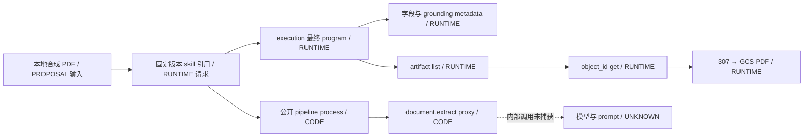

# 第三轮：公开 Skill、程序执行、工件与后台路径

采集：2026-10-13；隔日回读及交付复核：2026-10-14。研究对象：[Gateway](https://vlm.run/gateway)、[Dashboard](https://app.vlm.run/dashboard)。本轮延续前两轮证据，没有覆盖其原始文件。

**RUNTIME**：取得目录中全部 5 个公开 Skill 的 ZIP；6 次 Agent execution 完成；两次正式引用公开 Skill 返回 `execution_mode=program`；三次算术实验生成的 JSON artifact 可下载并与本地预期一致。**CODE/SOURCE**：获得 3 个公开 pipeline、5 份 Skill 指令、模型配置与 schema，补齐 System One 和 Dashboard 的多处调用细节。**UNKNOWN**：私有 router、全局 system prompt、沙箱底层和数据库实现仍未取得，不能把本轮完成等同于恢复全部后台。

导航：[逐请求与费用](round3-runtime.md)、[结构化汇总](round3-runtime-summary.json)、[执行协议与公开 pipeline](program-contract.md)、[Dashboard 与后端边界](backend-evidence-boundaries.md)、[System One 深入分析](../research/round3/systemone_source/findings.md)、[公开 Skill 原文 JSON](public-skill-sources.json)、[离线核查](round3-verification.md)、[哈希清单](round3-evidence-manifest.json)。

## 1. UNKNOWN 收窄到了哪里

|问题|新证据与类别|现在的边界|
|---|---|---|
|Skill 到底包含什么|**RUNTIME/STATIC**：5 个 ZIP 下载、解包；3 个有 pipeline，两个没有|公开包已逐文件可读；不代表所有内置工具或私有 Skill|
|真实代码入口|**CODE**：`async def process(ctx, doc_path)` 或 `process(ctx, img)`；通过 `ctx.import_lib("vlmrun")` 访问 proxy|公开包代码已知；ctx 类、runner、通用参数绑定实现未知|
|program 是否真有不同路径|**RUNTIME**：2 次公开引用最终 program/steps=0；4 次 inline 最终 agent|具体样本已区分；inline 未命中的原因及全部路由条件未知|
|grounding 输出是什么|**RUNTIME**：合成转诊单返回字段值、`*_metadata`、annotation IDs、文本和归一化 xywh|本样本可核对；注释生成、置信度模型及校准算法未知|
|artifact 读取如何走|**RUNTIME**：list→filename/object_id get→307→GCS 字节；下载 JSON/PDF 均可核对|接口及本样本存储位置已知；manifest 数据库和生命周期未知|
|隔日是否能再取到|**RUNTIME**：10 月 14 日回读两条 execution 200，并取回原 PDF|有限时间窗口成立；重启、TTL、跨区域与存储产品未知|
|System One 解码细节|**SOURCE**：regex 标签限制、mask 前 logprobs、逐题并行、关闭高熵 reread|官方声明已定位；专用 prompt、标签映射、canvas 构造源码未知|
|TypeSafe 是否完全等价|**SOURCE + RUNTIME-本机**：公开 confidence 公式不同；VLM 旧样本吻合熵公式|字段兼容不能推出数值等价或共用训练/后端|
|Dashboard 登录/历史路径|**CODE**：同源登录、业务 token 保存/刷新、历史双入口和过滤|客户端路径可追；同源 handler、签发与数据库未知|

## 2. 五个公开包：指令与实现分别核对

**RUNTIME**：[目录](../research/round3/captures/skills_list_current.response.json)返回 5 项，均标为 `is_public=true`。下载使用目录给出的 ID，经 `/v1/skills/{id}/download` 获得签名地址，再下载 ZIP。各包 `capture.json` 保存版本、成员和 SHA-256；API key 未写入归档。**STATIC**：本轮没有在本机执行下载的 pipeline；源码仅做读取、AST 与结构分析。

|公开名称|文件所表达的功能与差异|类别和来源|
|---|---|---|
|greeting|指令正文仅 `hello`；schema 为 response 字符串；YAML Orion-1 与 ParseInput→GenerateResponse→Output 图；无 pipeline|**SOURCE/STATIC**：[包](../research/round3/public_skills/greeting/capture.json)、[指令](../research/round3/public_skills/greeting/SKILL.md)|
|viasocket|图像客观描述指令、caption schema、Orion-1 图式配置；无 pipeline|**SOURCE/STATIC**：[包](../research/round3/public_skills/viasocket/capture.json)、[指令](../research/round3/public_skills/viasocket/SKILL.md)|
|grounded-document-extraction|加载包内 schema，调用一次 document.extract，传 `grounding=True, confidence=True`；schema 实际是 referral，含 `type.const=referral`|**CODE/SOURCE**：[pipeline:4](../research/round3/public_skills/grounded-document-extraction/pipeline.py:4)、[schema:7](../research/round3/public_skills/grounded-document-extraction/schema.json:7)|
|medical-multi-schema-extraction|第一次 extract 分类三种类型→读取对应 schema→第二次带 grounding/confidence 提取→返回 schemaUsed、documentType、rationale 和 data.pages|**CODE**：[pipeline:4](../research/round3/public_skills/medical-multi-schema-extraction/medical-multi-schema-extraction/pipeline.py:4)；**SOURCE**：[指令:11](../research/round3/public_skills/medical-multi-schema-extraction/medical-multi-schema-extraction/SKILL.md:11)明确 `execute_code(path=..., inputs={"doc_path": ...})`|
|healthcare-hipaa-release|指令/schema 描述 HIPAA 完整提取；YAML 指定 Orion-1；实际 pipeline 只有 caption、OCR，返回 caption/ocr_count/ocr_sample|**SOURCE/CODE**：[指令](../research/round3/public_skills/healthcare-hipaa-release/hipaa-release/SKILL.md)、[pipeline:1](../research/round3/public_skills/healthcare-hipaa-release/hipaa-release/pipeline.py:1)、[YAML](../research/round3/public_skills/healthcare-hipaa-release/hipaa-release/vlmrun.yaml)|

**UNKNOWN**：最后一个包的描述、schema 与 pipeline 为什么不一致，以及其 Orion-1 请求是否使用这个 pipeline。保留包内差异，不补写不存在的完整提取代码。

**SOURCE**：这些 `SKILL.md` 是公开领域指令。**UNKNOWN**：它们与 Orion planner/repair/global system prompt 的拼接顺序、条件注入与完整内容。公开模型 chat template 已在[第二轮附件](upstream-prompts.md)保存，它属于另一层。

## 3. 六次真实执行：请求意图与最终路径

**CODE/PROPOSAL**：[本地测试包](../research/round3/test_skills/round3-arithmetic-test/pipeline.py)只做两整数相加、原样返回随机 marker，并写 JSON；它是本次自制输入，不是恢复出的生产代码。执行脚本为 [investigate_round3.py](../tools/investigate_round3.py)。全部通过 `/v1/agent/execute` 提交、`/v1/agent/executions/{id}` 轮询。

|实验|请求|最终回包|核对结果|回包 USD|
|---|---|---|---|---|
|inline pipeline 首次|program|agent，4 steps，74 秒|17+25=42，marker 与 artifact 一致|0.050071|
|完全相同 ZIP 再提交|program|agent，3 steps，65 秒|31+19=50，marker 与 artifact 一致|0.033494|
|同 ZIP 显式 agent|agent|agent，2 steps，36 秒|17+25=42，marker 与 artifact 一致|0.023251|
|inline 无 pipeline|program|agent，1 step，3 秒|completed，但 response 是序列化 JSON 字符串，未精确满足预期|0.006702|
|引用公开固定版本，输入合成 invoice|program|program，0 steps，9 秒|返回 schema 固定 type 和其余 null/低置信度|0.002933|
|相同公开版本，输入合成 referral|program|program，0 steps，9 秒|字段和证据文本与本地合成内容吻合|0.003031|

以上均为 **RUNTIME**；秒数为回包 `usage.duration_seconds`，不是本地端到端基准。每行完整 ID、时间与回包：[首次](../research/round3/execution_program.observation.json)、[inline 重放](../research/round3/execution_replay.observation.json)、[agent](../research/round3/execution_agent.observation.json)、[无 pipeline](../research/round3/execution_fallback.observation.json)、[引用](../research/round3/execution_reference.observation.json)、[引用重放](../research/round3/execution_reference_replay.observation.json)。

**STATIC**：前 3 次请求的 inline Base64 ZIP 完全相同，重放仅改变请求模式或输入。[原始请求](../research/round3/captures/execution_program_submit.request.json)、[重放请求](../research/round3/captures/execution_replay_submit.request.json)。**UNKNOWN**：为何 inline 未命中固定程序路径；可能的缓存、技能解析或回退原因未出现在回包中，不能选一个当结论。

**SOURCE**：文档将 program 描述为固定 pipeline、无 LLM agent loop；失败或无缓存时回退 agent，见[代码执行说明:230](../research/docs/docs.vlm.run__agents__code-execution.md:230)。**RUNTIME**：本次只能直接观察最终 `execution_mode`、steps、内容和费用。`steps=0` 不等于整个任务没有模型调用——公开 pipeline 本身调用 `document.extract`，它的内部模型选择仍 **UNKNOWN**。

**RUNTIME**：多个 `running` 回包已含 `completed_at`，且早于该回包 `created_at`；提交与最终返回的 `created_at` 也有变化。[示例](../research/round3/captures/execution_program_poll_04.response.json)。**UNKNOWN**：字段刷新机制和根因。状态判断使用实际 status；不把非空 completed_at 当完成证据，不用这些不一致字段计算严格排队时延。

**STATIC**：6 个唯一 execution 的最终 usage 合计 **$0.119482**；与前两轮已报告数值相加为 **$0.204511**。这是返回字段加总，未核账户账单，也没有将重复轮询或 `credits_used` 重复折算为美元。

## 4. Grounding 与 artifact 端到端

**RUNTIME**：[合成转诊单](../research/round3/synthetic_referral.pdf)是本地生成的六行 PDF；[输入说明](../research/round3/synthetic_referral.json)明示为测试内容，不含真实患者。公开 Skill 指定版本 `20260720-b19b53d9` 的结果包括：

- `patient.givenName=Test`、`familyName=Example`、`dateOfBirth=2000-01-02`。
- `dateOfReferral=2026-10-13`、`reasonForReferral=Routine vision evaluation`、`schedulingPriority=Routine`。
- 字段旁新增 `*_metadata.confidence=hi`、`annotation_ids` 和 `bboxes`；缺失 provider 字段为 null/lo/空 IDs。
- `L0` 至 `L5` 与六行源文本对应；bbox 含 `page=0`、`xywh` 和 `confidence=0.99`。

来源：[最终回包](../research/round3/captures/execution_reference_replay_poll_02.response.json)。**STATIC**：这些 metadata 不在输入 schema 的 properties 中，[原 schema](../research/round3/public_skills/grounded-document-extraction/schema.json)顶层还写了 `additionalProperties=false`；本例表明 grounding 输出带额外元数据。**UNKNOWN**：服务端如何扩展/验证 schema、离散 hi/lo 与 0.99 的计算关系；单个样本不能证明概率已校准或所有坐标像素精确。

**RUNTIME**：另一张 invoice 测试也返回 `type=referral`，但该值就是 schema 的 const，其余数据为空。[该回包](../research/round3/captures/execution_reference_poll_02.response.json)。不能把这个输出解释为“正确识别 invoice 为 referral”。



**RUNTIME**：三次算术 artifact 列表各返回一个 `round3-result.json`、`source=manifest`；按 filename 读取后 307 到 `storage.googleapis.com`，无 API Bearer 下载 JSON，内容与 execution 返回值相同。[列表](../research/round3/captures/execution_program_artifacts.response.json)、[重定向](../research/round3/captures/execution_program_artifact_get.meta.json)、[字节内容](../research/round3/captures/execution_program_artifact_bytes.response.json)。这里 `source=manifest` 是回包字段，不足以确认 manifest 的数据库或文件格式。

**RUNTIME**：转诊单执行列出一个 PDF artifact，[目录](../research/round3/captures/execution_reference_replay_artifacts.response.json)。2026-10-14 根据此目录给出的 object_id 读取，得到 307→200；[下载元数据](../research/round3/captures/reference_pdf_object_bytes_next_day.meta.json)。**STATIC**：下载字节与最初合成 PDF 相同，见[离线核查](round3-verification.md)。这次可见 artifact 是输入 PDF，不能说服务端生成了新的报告 PDF。

**RUNTIME**：隔日读取两条 execution 均 200，返回原结果：[算术](../research/round3/captures/execution_program_next_day.meta.json)、[转诊](../research/round3/captures/execution_reference_replay_next_day.meta.json)。**UNKNOWN**：期间服务是否重启、是否跨副本、保存 TTL、缓存层与持久数据库。隔日仍可读取是有限观察，不是跨重启持久性证明。

## 5. System One：已公开的算法和仍缺的实现

**SOURCE**：VLM changelog 公开生成式路径的标签 regex 约束、grammar mask 前读取 logprobs、逐题并行和 shared prefix；兼容文档明确禁用高熵自动 reread、不支持 sequential、题组并行且 unconditioned。diffusion 文档说明 seed canvas、steps/samples 及多次采样。逐条锚点与源码路径见[专项分析](../research/round3/systemone_source/findings.md)。这些是官方说明，不是本轮抓到的服务器调用栈。

**SOURCE/RUNTIME-本机**：TypeSafe 当前公开 Choice confidence 采用 `(max(p)-1/K)/(1-1/K)`，VLM 文档采用归一化熵。对 10 月 11 日 VLM 已归档概率重算：熵公式 `0.9997378591522463` 与回包一致；TypeSafe 公式得 `0.9999699837228304`。保留采集日期差异，未重新请求两个远端验证当前版本。[公式与计算证据](../research/round3/systemone_source/offline-verification.json)。

**CODE/RUNTIME-本机**：TypeSafe SDK 负责校验、编码、HTTP 和解码；mock transport 已观察 `extra_body` 浅覆盖、题目 ID 保留、typed usage 丢弃 Gateway 费用扩展但原始 HTTP JSON 保留。27 个仓库 Python 文件与上一轮 wheel 对应源码一致；15 项离线核查通过。公开聊天模板的本地渲染不是 System One 专用 canvas prompt。

**UNKNOWN**：schema-to-prompt 原文、标签 token 映射、多 token 标签概率聚合、canvas seed/packing/padding、grammar 字符串、采样归一化顺序、生产引擎 commit 与部署参数。完整置信度或答案无法唯一反推这些变量。

## 6. Dashboard 与 Gateway 调用路径的补齐

**CODE**：Dashboard 实际登录客户端发同源 `POST /api/login {clerk_id}`；`/api/v1/login/clerk-user` 仅出现在共享拦截器豁免列表，不能充当已经执行的请求。登录回包可带 `initial_api_key`，按组织缓存；共享刷新 Promise 避免并发重复刷新，498 后按条件重试。详见[Dashboard 证据:1](backend-evidence-boundaries.md)。

**CODE**：历史读取有同源缓存入口与 Agent 直读入口；401/403 被客户端转成空消息，展示又过滤 tool 角色与反馈文本。**INFERENCE**：界面缺消息不足以证明服务端没有保存。服务端缓存产品、TTL 和 owner 判定仍 **UNKNOWN**。

**SOURCE**：Gateway OpenAPI 还明确 embedding 在 router 处归一成 item 列表、provider 按请求报告、OCR/detection JSON envelope 由 Gateway 构造。它们补齐接口层职责，未给出私有 adapter 实现。旧文档/SDK/前端与新回包的全部差异见[协议附录](program-contract.md)与[边界审计](backend-evidence-boundaries.md)。

**STATIC**：第二轮历史 request JSON 未保存附加 headers，因此当时的 token 差异复核还依赖采集代码与运行记录；本轮采集器已保存 header 名称和脱敏值，历史文件未回写。相同 API Key 不能独立证明服务端认定为会话 owner。

## 7. 剩余 UNKNOWN 的具体关闭条件

|未取得的实现|当前已知|还缺什么直接证据|
|---|---|---|
|Gateway router/adapters|接口、路由回包、部分公开职责|对应生产 commit 的源码、依赖锁或入口→adapter trace|
|Orion 全局提示词/repair loop|公开 Skill 指令、执行输出、前轮 retry 事件|实际上下文组装源码或脱敏的完整 engine request|
|Program runner 与缓存|公开 process 函数、两个 program 结果、inline 对照|CodeExecutionRunner、cache key/命中日志、失败回退日志|
|document.extract 与 grounding|公开 proxy 调用、真实字段/IDs/bboxes|提取/注释工具实现、逐步骤 trace、模型调用参数|
|System One 内部模板与 canvas|文档算法、旧概率回包、SDK|prompt/grammar/label mapping/canvas positions 及引擎调用|
|xberg/PDF 生产配置|回包 backend、上游候选源码|部署依赖版本、feature/config、PDF rasterizer 调用|
|算力、队列、沙箱|公开结构说明和任务状态|部署 manifest、镜像/SBOM、调度与执行器配置|
|session/artifact 数据层|接口、GCS 下载、隔日读取|表/集合结构、owner 判定、TTL/清理规则、重启前后观测|
|Dashboard 登录/ticket/key/billing|客户端路径、鉴权文档、usage|对应服务端 handler、存储结构与账单关联记录|

**UNKNOWN** 不是推测答案的占位许可。现有外部回包、公开源码和文档支持本报告中的具体边界；缺失材料未取得，故未将数据库品牌、沙箱供应商、私有提示词或生产源码写为已恢复。

## 8. 交付复核

**RUNTIME-本机**：第三轮 27 项离线核查通过，前两轮分别 16、20 项复核通过。结果保存在[第三轮核查](round3-verification.md)、[第一轮](verification.md)、[第二轮](round2-verification.md)。核查覆盖历史证据哈希、新 HTTP/ZIP 哈希、6 次路径与费用、artifact 字节、grounding 文本、请求脱敏、脚本语法和报告链接。核查通过表示归档与相应有限样本条件成立，不表示所有模型或所有后台路径均已验证。

```powershell
python tools\summarize_round2.py
python tools\summarize_round3.py
python tools\verify_delivery.py
python tools\verify_round2.py
python tools\verify_round3.py
```

这些命令读取本地证据，不发送推理请求。专项 System One 的 15 项核查已有独立结果；本轮未重跑所有模型 benchmark，也没有创建持久化测试 Skill 注册记录。
