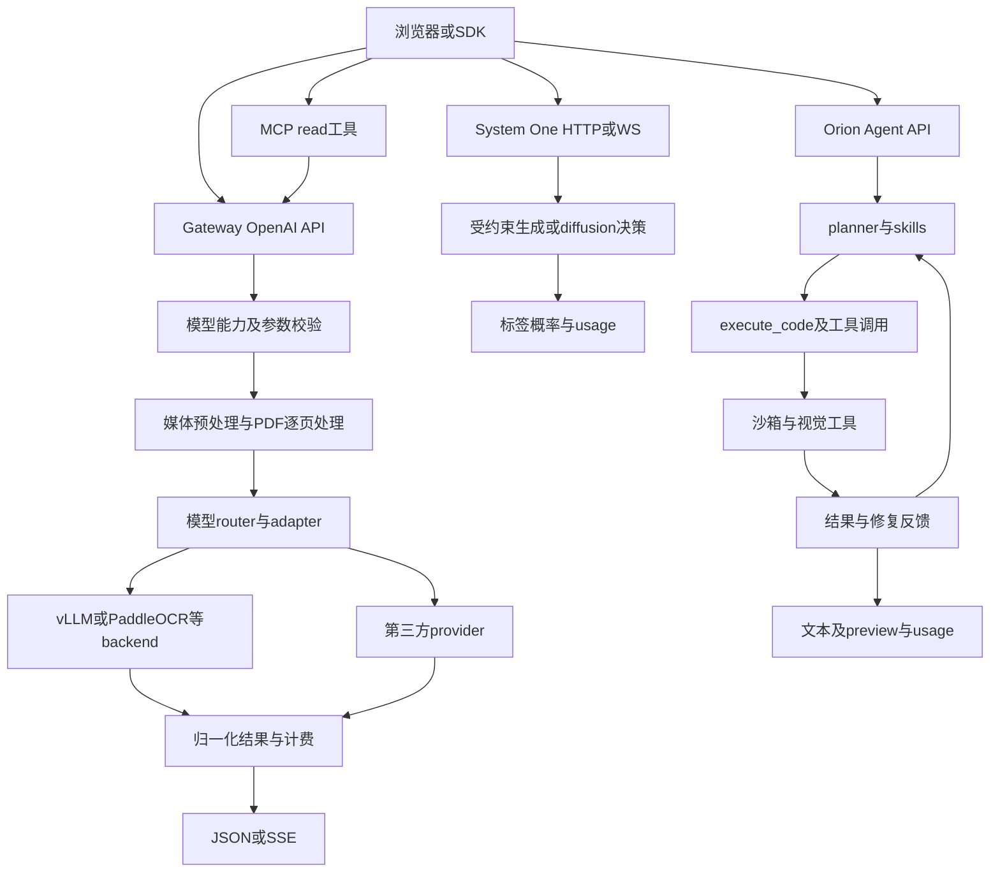

# VLM Run Gateway / Agent 深度分析（可追溯版本）

> 2026-10-13后续取证已更新部分UNKNOWN：[第二轮报告](unknowns_round2_2026-10-13.md)。模型目录增至26项；xberg后端、WebSocket单帧、token绑定会话回读和MCP空目录已有运行证据，另取得上游模板。下文保留10月11日观察，不将旧失败结果改写成当时成功。

证据采集：2026-10-11（Asia/Shanghai）。离线复核与交付整理：2026-10-12；未在12日重新调用生产接口。

## 0. 证据边界

本报告把事实分为 `SOURCE`（官网/文档原文）、`CODE`（公开 SDK/前端代码）、`STATIC`（对公开文件的静态检查）、`RUNTIME`（本次实际请求或执行回包）、`INFERENCE`（基于上述证据的推断）、`UNKNOWN`（公开证据不足）。

本次检索未取得完整服务端源码、私有 system prompt、GPU/队列/数据库/部署拓扑，本报告不把推断写成已知事实。原始材料、请求、回包、哈希和元数据在 `research/`；采集工具以隐藏输入接收 Key，保存的请求头使用 `[REDACTED]`。

配套文件：[完整模型表](models.md)、[模型 CSV](models.csv)、[接口全表](endpoints.md)、[公开提示词原文](prompts.md)、[运行结果及异常](runtime-verification.md)、[来源与行号](evidence-index.md)。

## 1. 结论摘要

1. **Gateway 与 Agent 是两条服务链。** Gateway 使用 `https://gateway.vlm.run/v1/openai`；Agent/Orion 使用 `https://api.vlm.run/v1/openai`。System One 是 Gateway 下独立的 `/typesafe` HTTP/WebSocket 路由（`research/runtime/gateway_openapi.json`、`api_openapi.json`）。
2. **Gateway 当前运行目录是 24 项。** `GET /v1/openai/models` 在本次返回 24 个条目；网站静态 catalog 也是 24 个 served 条目，另外 2 个标记为 coming-soon（`roboflow/rf-detr-large`、`lightonai/lightonocr-1b-1025`），未出现在运行目录（`RUNTIME`：`research/runtime/gateway_models.response.json`；`STATIC`：`research/frontend/catalog.static.json`）。
3. **目录声明的能力覆盖专用 CV 与多模态 chat：** OCR/Markdown/layout、检测、分割/跟踪、姿态、caption/chat、视频理解、音频转写、embedding。Agent 工具另声明图片/视频生成。各接口的能力元数据还存在不一致，见完整模型表；目录声明与实测成功分开记录。
4. **已实际验证的接口路径：** 文本 chat、图片 JSON schema、SSE、PP-OCRv6 图像 OCR、两页 PDF 处理、embedding、System One、Orion-1 Agent，以及 Orion-2 的 `execute_code` 调用事件。PDF内部fan-out和沙箱实际执行过程没有独立trace；回包分别报告 `backend=vllm`、`backend=paddleocr`、`system_fingerprint`、`usage.cost` 等运行字段。
5. **Orion-2 官方定义是围绕 VLM 的 agent harness。** 白皮书将早期 Orion 描述为 `LLM planner → tool execution → VLM verifier` 的 Plan–Execute–Reflect 框架（`SOURCE`：`research/runtime/orion_whitepaper.txt` 第 2.1 节；文件版权标注2025）；较新的 blog/代码执行文档描述 Orion-2 为模型生成 Python、沙箱执行、并行独立操作、失败重试/回退（`SOURCE`：`research/docs/docs.vlm.run__agents__code-execution.md`）。本次回包在同一请求中出现 `vlmrun-orion-2` 的 `execute_code` tool call 和 `vlmrun-orion-1:auto` 的文字流；这是事件字段观察，不能仅凭它证明实际调用了哪些基础模型。
6. **隐藏 prompt 无法全部恢复。** 可见的是用户 prompt、公开 Hub/Skill 文本、前端 OCR judge/copilot prompt 和方法参数 prompt；平台 system prompt、Agent planner prompt、工具 schema 的私有版本仍 `UNKNOWN`。

## 2. 服务分层与请求路径

流程图依据：边缘接口及部分 backend 为 RUNTIME；校验/预处理/router/沙箱内部连接为官方 SOURCE 架构描述。图不表示已取得内部调用栈。



### 2.1 Gateway

- `SOURCE/CODE`：Python SDK `vlmrun/client/gateway.py` 和 Node SDK `src/client/gateway.ts` 默认根为 `https://gateway.vlm.run/v1`，OpenAI 资源追加 `/openai`；SDK 将 `method`、`document_dpi`、`video_fps` 等 Gateway 扩展放入 `extra_body`，本身是 passthrough client，不是后端实现（`research/code/findings.md` 的仓库锚点）。
- `RUNTIME`：健康回包：`status=ok`、版本 `0.46.1`、commit `22662785cf033f58833444257685356853fb4e87`、部署标记 `26-10-01`（`research/runtime/gateway_health.response.json`）。HTTP server header 为 `uvicorn`。
- `RUNTIME`：Qwen 文本和视觉回包含 `backend=vllm`、`system_fingerprint=vllm-0.30.0-9b65a544`；PP-OCRv6 回包含 `backend=paddleocr`；这只确立了本次请求所报告的 serving backend，不代表所有模型或整个网关都使用同一栈。
- `SOURCE`：官方 [Introducing Gateway](https://vlm.run/blog/introducing-gateway) 写明一个 router 后接五种 runtimes，每个模型是独立 plugin，用于隔离依赖，模型常驻；该文没有给出五种 runtime 的完整生产清单。blog 的常驻说法与 error-codes 文档的 cold start 描述并存，不能外推“生产永不冷启动”。本次只核验了两种 backend 字段。

### 2.1.1 Provider 与权重元数据

`RUNTIME`：目录明确将两项 Gemini Flash 标为 `google-vertex`、Robotics 标为 `google-gemini`、Muse Spark 标为 `meta`，Kimi/MiniMax/Muse Glimmer 标为 `fireworks`。这是接口报告的 provider，未取得上游网络请求。其余目录的 `provider` 为空，官网静态分类将它们列为 served。

`RUNTIME`：`hf_model_id` 还公开权重标识，例如 Qwen0.8B 为 `AxionML/Qwen3.5-0.8B-NVFP4`，Gemma4 为 `nvidia/Gemma-4-26B-A4B-NVFP4`，DiffusionGemma 为 `nvidia/diffusiongemma-26B-A4B-it-NVFP4`，Qwen27B 为 `Qwen/Qwen3.8-27B-FP8`。它们是目录声明的模型来源，不能证明实际加载文件的 checksum、训练数据或全部量化配置。

`SOURCE/RUNTIME`：`vlm-run/ocr:auto` 的描述给出明确方法路由：`ocr → PP-OCRv6`；`markdown → fast CPU parser，错误时 dots.mocr`；`layout → dots.mocr`。该字符串在两种 API 元数据中一致，但本次未调用这个路由器；CPU parser 的具体实现仍 `UNKNOWN`。

### 2.2 Agent / Orion

- `RUNTIME`：`GET https://api.vlm.run/v1/openai/models` 返回 Orion IDs：`vlmrun-orion-1`、`:auto`、`:fast`、`:pro`、`vlmrun-orion-2`、`:auto`、`vlm-1`、`vlmrun-orion-2:qwen3.8-27b`（`research/runtime/agent_models.response.json`）。
- `SOURCE`：OpenAPI 的 `AgentChatCompletionsRequest` 明列 `tools`、`tool_choice`、`tool_execution=client|hybrid`、`server_tools`、`expose_server_tool_calls`、`preview`、`session_id`、`session_token`、`skills`、`service_tier` 等字段（`research/runtime/api_openapi.json`）。`hybrid` 可启用服务端工具，默认服务端工具为 `execute_code`；这是公开接口描述，不等于私有执行器源码。
- `SOURCE`：`AgentExecutionConfig.mode` 为 `agent|program`；`agent` 是完整 LLM loop，`program` 在有缓存 pipeline 时执行固定 `pipeline.py`。公开文档还描述首次 authoring → 缓存 → subsequent replay → 失败回退到 agent loop（`research/docs/docs.vlm.run__agents__code-execution.md` 第约 225–312 行）。
- `RUNTIME`：一次 Orion-2 probe 的 SSE 解析结果在 `research/runtime/probe_orion2_tool.decoded.json`：出现 `execute_code` tool call，代码参数为 `async def process(ctx): result = sum(i * i for i in range(1, 6)); return {"result": result}`，最后文字输出 `55`；usage 为 `prompt_tokens=42646`、`completion_tokens=538`、`reasoning_tokens=74`、`cost_dollars=0.014139`。未返回独立工具结果、stdout或退出状态，且模型在调用事件之前已算出55；因此只确认调用事件与最终答案，实际沙箱执行成功与否未独立验证。

### 2.3 批处理、文件、Schema 与产物

`CODE`：公开 Python SDK 的 `agent.execute` 构造 `POST /v1/agent/execute`，包含 model/name/batch/inputs/config/metadata/callback_url/toolsets；当前该客户端函数在 `batch=False` 时直接抛 NotImplementedError。`SOURCE`：OpenAPI 提供 `/v1/agent/executions/{id}` 查询，文件 upload/presigned/verify，skills create/update/download，artifacts，以及 document/image/video/audio generate 和 evaluations run/optimize/rerun。完整清单在 [endpoints.md](endpoints.md)。这些函数名并不揭示队列或数据库实现。

`SOURCE`：Skill 包由 `SKILL.md`、`schema.json`、`vlmrun.yaml` 等文件组成；YAML 指定 model/toolsets/graph，graph 采用 Mermaid stateDiagram-v2。Orion-1 将 skill instructions 注入 system prompt；Orion-2 把 skill 文件写入工作目录，通过文件读取与程序复用。官方 cookbook 的多 schema 示例为 classify → 选 `schemas/<documentType>.json` → document.extract；这只确立公开示例流程。

`RUNTIME`：本次 `/v1/hub/schema` 返回 document.invoice 的 `schema_version=0.1.35`、JSON schema、GraphQL 字段列表、schema hash；回包没有 prompt 字段（`hub_invoice_schema.response.json`）。本次 Orion-2 响应带 session_id，但用该 ID 调用 `/v1/chat/messages` 返回404 `Session not found`，所以会话实际持久化/可回读行为未验证，不能从字段名直接下结论。

### 2.4 MCP：把同一视觉流水线包装成 Agent 工具

`SOURCE`：[MCP Tools](https://docs.vlm.run/gateway/mcp-tools) 声明 `/mcp` 提供 read_document/read_image/read_audio/read_video/list_models/get_model_info/get_completion。工具按当前 served 模型动态挂载；read_* 接受 URL 或内联媒体，映射到对应 model/method/json_mode；routed provider 和 embedding 不在 read-tool 模型菜单中。它是另一种协议入口，不代表又训练了一组模型。

`SOURCE`：[MCP Authentication](https://docs.vlm.run/gateway/mcp-authentication) 描述 API bearer 或部署启用的 Clerk OAuth，公开 OAuth discovery、authorize/token/register 路径。注册/登录与生产数据存储实现仍未知。本次只读取 MCP 初始化/工具目录，不调用读取媒体的 MCP 工具。

`RUNTIME`：初始化200、initialized通知202、tools/list 200。回包实际有以上7个工具，携带 inputSchema/outputSchema、description 和 annotations，`_meta.fastmcp` 标记可见（[MCP原始工具定义](../research/runtime/mcp_tools.response.json)）。例如 read_document 模型枚举仅6项，不等于REST的24项；read_image默认prompt为 `Describe this image in detail.`。这批工具schema可直接研究调用约束，但不等于Orion私有全部工具schema。

`RUNTIME`：initialize另返回 `serverInfo={name:vlmrun, version:4.0.10}`、协议版本 `2025-03-26` 和完整 `instructions`。该instructions直接指导客户端选择read_document/read_image等工具，原文收录在[prompts.md](prompts.md)；服务自报版本4.0.10与Gateway健康版本0.46.1属于不同响应字段，不据此推定包版本相同。初始化还声明prompts/resources能力，本次未调用prompts/list或resources/list，因此其条目内容UNKNOWN。

## 3. Gateway 模型与能力（本次目录）

以下按运行时 `data[]` 的 `task/methods/capabilities` 分类，名称与价格均为 `research/runtime/gateway_models.response.json` 快照（`RUNTIME`），不是永久保证：

| 类别 | 运行时模型/能力 | 关键限制或字段 |
|---|---|---|
| 通用多模态 chat | `google/gemini-3.5-flash-lite`、`google/gemini-3.7-flash`、`meta/muse-spark-1.2`、`google/gemini-robotics-er-2-preview`、`moonshotai/kimi-k3`、`minimax/minimax-m3`、`meta/muse-glimmer-30b`、`google/gemma-4-26b-a4b-it`、`qwen/qwen3.5-0.8b`、`qwen/qwen3.8-27b` | 文本/图片/视频上限、context、schema/tool 参数按条目不同；Gemma4/Qwen 可到多图或单视频；Muse Glimmer 的 `supports_json_schema=false`；DiffusionGemma 条目为 `supports_json_object=false`（运行快照）。 |
| OCR / 文档 | `microsoft/florence-2-base-ft`、`paddleocr/pp-ocrv6`、`deepseek-ai/deepseek-ocr-2`、`rednote-hilab/dots.mocr`、`paddlepaddle/paddleocr-vl-1.6`、`baidu/unlimited-ocr`、`vlm-run/ocr:auto`、`zai-org/glm-ocr` | `methods` 由 `ocr/markdown/text/layout/table/formula/chart/...` 组成；PDF 以 document/file URL 传入；专用 OCR 多数不支持 json schema。 |
| 视觉专用 | `facebook/sam3.1`、`usyd-community/vitpose-plus-large`、`geopavlakos/hamer` | 分割/跟踪/姿态/手部 mesh；SAM track采样参数放 `method_params`，ViTPose cadence使用顶层 `video_fps`（SOURCE：各模型卡）。 |
| 音频/向量 | `nvidia/parakeet-tdt-0.6b-v3`、`qwen/qwen3-vl-embedding-2b` | `/audio/transcriptions` 与 `/embeddings`；embedding 本次返回 32 维向量。 |

补充：目录中还含 `google/diffusiongemma-26b-a4b-it`，用于 chat 与 System One。它的 list 接口 `supports_json_object=false`，detail 接口却为 `true`；因此连两处运行元数据也冲突，本次未对此模型执行 JSON chat，不能擅自选择一种作为已验证行为。24 个 API ID 也不等于24套独立权重：`vlm-run/ocr:auto` 自述为路由器，部分 ID 是上游 provider 路由。

## 4. 端到端功能流程

### 4.1 Chat / 多模态

1. 客户端构造 OpenAI `messages`；content part 可为 `text`、`image_url`、`video_url`、`document_url`、`file_url`。
2. Gateway 按模型目录校验 `supported_input_types`、`max_images/max_videos`、method 和参数；错误以 `capability_violation` 返回（本次 Florence 无图片请求返回 400，`research/runtime/probe_capability_error.response.json`）。
3. 服务端将媒体送入对应 backend；Qwen 本次回包报告 `vllm`，PP-OCRv6 报告 `paddleocr`。
4. 非流式返回 OpenAI completion；`stream=true` 返回 SSE。文本和 OCR JSON stream 本次均返回 `text/event-stream`，最终 chunk 携带 usage；JSON mode 的 payload 在本次 OCR probe 中被分片到 SSE，完整 JSON 需要客户端拼接（`research/runtime/probe_ocr_json_sse.response.txt`）。

### 4.2 PDF / 文档

- `SOURCE`：公开文档称 PDF 会 rasterise，按页处理，支持 `document_dpi`、`document_pages`、`document_max_pages`；System One 读取 PDF 的前 8 页，长文档则走 Gateway per-page pipeline。
- `RUNTIME`：合成两页 PDF + PP-OCRv6 返回 `<document mimetype="application/pdf" npages="2" dpi="96">`，每页独立 `<page id=...>`，文本正确分开；回包见 `probe_pdf.response.json`。
- `UNKNOWN`：PDF rasterizer 具体库、页级队列、缓存 key、worker 调度、失败重试实现未公开。

`SOURCE`：普通 Gateway PDF 文档公布256 MB、128页、默认96 DPI；这与 System One 的前8页限制是两种合同。页失败行为也有公开定义：临时错误一页共尝试3次；确定性超大 raster 不重试；部分页成功返回200并逐页标记 error，全页失败返回502且文档称不计费。流已开始后只能在内容中标错，无法回改 HTTP 状态。对应本次成功 PDF 不包含失败页，所以这些恢复路径尚未实测。

### 4.2.1 坐标、mask 与前端绘制

`SOURCE`：response-types 定义归一化 `bbox_xywh=[x,y,w,h]`、`poly_xy`、score、doc.page.blocks/doc.ocr.lines 等判别字段；SAM mask 是每图/每帧一张 PNG label map，像素值对应 instance_id/track_id（1–255，0为空）。`RUNTIME`：PP-OCRv6 图像响应确有 bbox/poly/score；JSON mode 增加原图 hash/width/height。由归一化坐标乘原图宽高获得显示坐标，是对该 schema 的直接数学解释，并非识别到私有渲染实现。SAM/视频mask本次未执行。

### 4.3 System One

- `SOURCE`：请求是 `state + questions`，问题类型 `noul`（P(yes)）、`choice`（离散分布+confidence）、`score`（期望等级+分布）；一次最多 16 个问题，内容可为文本、最多 8 张图片或一个 PDF。公开文档称 generative engine 的概率在 temperature 1，diffusion engine 用 denoise steps，默认 steps=1。
- `RUNTIME`：Qwen 文本请求返回 `noul=0.5312`、`output_tokens=5`；DiffusionGemma 同状态返回 `noul=0.9999767`、`output_tokens=0`，附加 choice 的概率接近1。两次都 `reads=1`，但问题集合不同，不能视为严格控制的模型对照基准。
- `SOURCE`：WebSocket 协议为 `session.create` → raw binary frame → `decision`/`frame.dropped` → `session.close`/`session.stats`。本次连接在 Windows 客户端超时，未取得 RUNTIME 事件（`probe_websocket.json`），因此 WebSocket 性能未验证。

`SOURCE`：System One API 文档进一步公开 `confidence = 1 - H(p)/ln(K)`、`score = Σ(i × p_i)`。typesafe-models/changelog 将计算拆成两种：DiffusionGemma 在 seeded canvas 上去噪并读取概率；generative engine 在 grammar 约束下输出答案模板，每个 question 并行调用并复用 shared prefix，label logprobs 在 grammar mask 前读取。较小引擎分布可更接近 uniform；文档也承认 generative read 不保证经验校准。训练/校准集、温度拟合、具体 prompt 模板仍未知，因此不能把“calibrated”营销词视为本次准确率验证。

`SOURCE`：WS 文档给出默认 max_inflight=2、最多8，frame上限2MiB、replica最多64 sessions、idle30秒；忙时丢帧而非无限排队。本次没有连接成功，不将官方约44ms p50写成本次测量。

### 4.4 Orion-2 code execution

```text
用户 messages / media
  → planner 生成程序（SOURCE：官方文档/白皮书）
  → execute_code（RUNTIME：本次 SSE tool_call）
  → sandbox 中调用 cv2/numpy/matplotlib/ffmpeg/vlmrun 等库（SOURCE）
  → 结果/日志/preview 回到 agent
  → 执行结果检查与修复；失败时 retry 或回退 agent loop（SOURCE）
  → OpenAI text/tool/usage SSE
```

公开文档列出 `vlmrun.image.*`、`vlmrun.document.*`、`vlmrun.video.*`、`vlmrun.llm.extract`、`vlmrun.io.*` 等代理 API；这说明公开能力面，不等于内部 Python 包的完整源码。

版本区别：早期Orion白皮书描述VLM verifier；Orion-2博客则把visual judge闭环写成后续工作（SOURCE，blog第55行）。不能把早期架构与新版规划合成“当前每次Orion-2都调用judge”的事实。

## 5. 提示词与可见性

### 5.1 可直接看到的 prompt（`SOURCE/CODE/RUNTIME`）

- Gateway 用户 prompt：前端将用户内容放入 `messages`；本次检查的公开材料中未发现固定 Gateway system prompt 原文。
- DeepSeek grounding OCR method prompt：`<image>\nLocate <|ref|>title<|/ref|> in the image.`（模型卡/静态 catalog）。这是方法参数，不是平台 system prompt。
- Hub schema prompt：例如 invoice：`You are a detail-oriented invoice analyst. Extract all the relevant information from the candidate's invoice as accurately as possible.`（`research/code/vlmrun-hub/vlmrun/hub/catalog.yaml`）。该文本是 Hub schema workflow 的公开 prompt，不能推断 Gateway/Orion 必然原样拼接。
- Chat Playground OCR prompt：`Extract all visible text from this document and return clean Markdown. Preserve reading order, headings, paragraphs, lists, tables, formulas, and page boundaries. Do not summarize, explain, or omit content. Return only the extracted document.`（`research/frontend/chat_pretty/chat__74720-951f38767fc2ea11.js`）。这是浏览器功能的用户级 prompt。
- Playground OCR judge prompt：要求对每个模型按 overall/completeness/accuracy/formatting 0–100 打分并只返回 JSON（同上 JS 文件）。这是前端评测逻辑。
- Skill copilot prompt：前端明确写入 `You are an AI copilot helping edit files in skill ...`，要求修改时输出以目标文件名为语言标识的完整代码块（`research/frontend/chat_pretty/chat__6116-f482cec466098f22.js`）。这是 skill 编辑器 copilot，不是 Orion 隐藏 prompt。
- `RUNTIME`：MCP initialize 回包的完整 `instructions` 与工具目录中的默认用户 prompt 已收录在 [prompts.md](prompts.md)；它们是客户端可见的协议字段。

### 5.2 明确不可见的 prompt（`UNKNOWN`）

- Gateway OCR/检测/分割/视频默认 system template；
- Orion planner、tool-selection、reflection/verifier、错误修复 prompt；
- Agent 注入的完整 system prompt、skill 版本化内部 prompt、模型路由规则；
- 生产环境的 provider-specific chat template 及其拼接顺序。

本次 Orion SSE 中 `<think>` 文本是模型输出事件，不应误写成平台 system prompt；`prompt_tokens=42646` 也不能反推出 token 内容。

## 6. 前端和认证链路（公开静态证据）

- `STATIC/CODE`：`vlm.run/gateway` 是 Next.js/Vercel 预渲染页面；页面静态 catalog 含 24 served + 2 coming-soon，并嵌入方法 schema、demo prompt 和静态 `result.json/overlay.svg` 路径。静态 demo 结果不是本次推理结果。
- `STATIC/CODE`：Chat Playground JS 默认 Agent base 为 `https://agent.vlm.run/v1`，Gateway 走同源 `/api/gateway`；请求 body 可包含 `session_id`、`stream:true`、`preview:true`、`skills`、`toolsets`、`models`、`canvas_schema`、`session_token`、`max_tokens`、`temperature`、`seed`、`response_format`、`chat_template_kwargs.enable_thinking=false`。
- `CODE`：未登录重定向页公开加载的共享API客户端，其base为 `https://prod-vlm-cloud-nfsnfpr33q-uc.a.run.app`，从 `localStorage.access_token` 加Bearer；498且尚未重试、存在refresh_token时调用 `/api/v1/refresh-token`，成功取得access_token才重试。此次访问dashboard重定向到 `/sign-in?redirect_url=%2Fdashboard`（`RUNTIME`：`research/runtime/dashboard.meta.json`），未登录验证该刷新流程。
- `CODE`：Playground在浏览器调用fingerprint库获取visitorId并缓存于sessionStorage；另通过POST `/api/agent/playground-ticket`取得ticket（JS第674–701行）。`UNKNOWN`：服务端对fingerprint的使用/校验规则、ticket签发实现、同源Gateway代理实现，以及dashboard Cloud Run业务源码和数据层。

## 7. 计费、限流和错误行为

- `SOURCE`：Gateway 文档公布匿名 `10/min, 30/hr, 100/day`；有效 API key 为 `240/min, 10000/hr`；模型 `pricing` 是 USD/1M tokens、images、video 或 audio seconds，且每次调用最低 `$0.001`（具体以模型卡）。
- `RUNTIME`：Gateway 小模型文本/视觉/OCR/PDF/System One 本次多数回包 `cost=0.001`；embedding 回包 cost 为 0；Orion-1 回包为 `cost_dollars=0.002883`，Orion-2 probe 为 `0.014139`。这些是本次响应usage报告的金额，未核对账户账单或实际扣款。
- `RUNTIME`：Frontier `google/gemini-3.5-flash-lite` 请求返回 403 `model_not_entitled`，消息要求组织启用付费账户；不能把“目录可见”当作“当前账户可调用”。
- `RUNTIME`：无图片调用 Florence 返回 400 `capability_violation`；证实 API 拒绝此输入。是否在特定 router/worker 函数中完成校验，属于 `UNKNOWN`。
- `SOURCE/UNKNOWN`：文档称计数器通常在 serving process，若配置 `VLMRT_RATE_LIMIT_STORAGE_URI` 才共享；是否由生产部署启用共享存储未知。

`SOURCE`：error-codes 文档还公布每 ingress replica 等待队列最多256条，队列满同样429但 Retry-After=60；默认首token期限30秒、总期限600秒，Qwen27B/Unlimited-OCR首token60秒。文档称流式路由先等待首chunk再发HTTP响应，因而首token超时仍可返回504。相关常量是官方描述，本次没有施加拥塞或长等待来验证。

`STATIC`：所有成功推理 POST 回包报告的金额合计 **USD 0.026022**；不是账户余额/账单核对。completion GET 报告原请求成本，未重复累计。[逐次记录](runtime-verification.md)。

## 8. 公开后端实现路径：已知、推断、未知

### 已知（`SOURCE/CODE/STATIC/RUNTIME`）

- OpenAI-compatible HTTP/SSE 路径、认证 header、模型目录和请求 schema；
- 媒体 content-part 约定、PDF/page envelope、method 与 response_format 分离；
- 运行时报告的 vLLM / PaddleOCR backend；
- MCP握手、7个公开工具的完整schema及描述；
- Orion 的公开模式、tool_execution、execute_code、skills、program pipeline 和公开工具库；
- Hub schema prompts、浏览器用户级 OCR/评测/copilot prompts；
- 公开错误码、usage、cost、request ID、模型 entitlement。

### 合理推断（`INFERENCE`，不是源码事实）

- Gateway 很可能是“统一 FastAPI/ASGI 路由 + 按模型选择 adapter + 后端 worker”的组合，因为公开 OpenAPI、uvicorn header、模型 capability/error envelope 和 vLLM/PaddleOCR backend 字段彼此一致。
- PDF fan-out 很可能在 Gateway 或专用 document worker 内先栅格化，再按页并发/合并，因为文档声明与实际 `<page>` envelope 一致。
- Orion-2 的一次请求可能跨 planner、代码执行器和 verifier/文本模型，因为官方架构声明和本次 SSE 出现多个 model id；具体调用次数、队列和上下文拼接仍未知。

### 未知（`UNKNOWN`）

- 私有服务端仓库、部署拓扑、负载均衡、队列、数据库、缓存、GPU placement；
- 所有 provider adapter 的实现、上游 provider 实际请求体、模型权重/量化文件位置；
- 完整 system prompt、planner/verifier prompt、路由打分；
- 生产环境重试次数、超时、熔断、跨副本限流一致性；
- 账单数据库写入、API key 哈希/轮换和内部审计流程。

## 9. 已执行探针索引

| 探针 | 结果 | 证据 |
|---|---|---|
| health/models | 200 | `research/runtime/gateway_health.response.json`, `gateway_models.response.json` |
| 文本 chat | 200，返回 `VLM_GATEWAY_OK` | `probe_text.response.json` |
| 视觉 JSON schema | 200，返回 invoice_id/currency/total | `probe_vision_schema.response.json` |
| 普通 SSE | 200；控制 probe 拼接为 `VLM_GATEWAY_OK` | `probe_sse_control.response.txt` |
| PP-OCRv6 image | 200，含 normalized bbox/poly/score | `probe_ocr.response.json` |
| PP-OCRv6 PDF | 200，两页 `<document>/<page>` | `probe_pdf.response.json` |
| embedding | 200，32 维 | `probe_embedding.response.json` |
| System One Qwen/DiffusionGemma | 200，noul/choice/probabilities | `probe_systemone*.response.json` |
| Orion-1 | 201，`AGENT_OK`，usage 含 credits/cost | `probe_agent.response.json` |
| Orion-2调用事件 | 200 SSE，tool call + Python参数 + 最终文字`55`，无独立执行trace | `probe_orion2_tool.response.txt`, `probe_orion2_tool.decoded.json` |
| model entitlement | 403 `model_not_entitled` | `probe_provider.response.json` |
| invalid capability | 400 `capability_violation` | `probe_capability_error.response.json` |
| completion readback | 200，返回 status/latency | `probe_completion.response.json` |
| System One WebSocket | 未验证；本次连接超时 | `probe_websocket.json` |
| MCP初始化及目录 | 200/202/200，7个工具 | `mcp_initialize.response.json`, `mcp_tools.response.json` |
| Hub invoice schema | 200，schema/GraphQL/hash，未返回prompt | `hub_invoice_schema.response.json` |
| Orion-2会话回读 | 404，Session not found | `probe_orion2_history.response.json` |

## 10. 复现工具

- `tools/capture_api.py`：只允许 `gateway.vlm.run` / `api.vlm.run`，请求文件只写 `[REDACTED]`，支持 discovery、单请求和 batch。
- `tools/prepare_probes.py`：生成合成 PNG/PDF 和显式 probe manifest；合成输入不是产品样本。
- `tools/probe_websocket.py`：按公开协议做一次 System One WS 探针，失败也保存错误元数据。
- `tools/probe_mcp_catalog.py`：初始化 MCP 后读取 tools/list，未执行媒体工具。

## 11. 尚存冲突与实际影响

|证据冲突|本次结论|
|---|---|
|list 与 detail 的输入/method/JSON能力不同|已逐字段列在 models.md；Parakeet list甚至给 text/image，而detail给 audio/video，不适合直接据list生成全部调用表单。|
|兼容页称 JSON never streamed；response-formats称先缓冲再发SSE|本次PP-OCRv6 JSON+stream返回SSE；没测chunk到达时刻，缓冲位置仍未证实。|
|Python CLI旧注释称 response_format 未被服务端遵守|本次Qwen图片提取返回符合所给schema的JSON，OCR JSON也成功；无法由一个样本证明全模型严格解码。|
|视频文档分别写 encoded to images 与 native-only|未实测视频，不指定唯一内部解码路线。|
|Gemma4官网分别写80K和128K|本次list/detail均81920，未做上下文极限测试。|
|SKILL称所有模型JSON mode；DiffusionGemma list false/detail true|公开资料与运行元数据本身不一致，该具体模式未知。|
|System One概念页约20问题；schema最多16|API声明约束为16，概念性性能描述不是额外容量。|
|Code execution文档和SDK注释称默认program；OpenAPI声明默认agent|Python SDK实际mode默认None，省略时交给服务端；实际省略mode的执行分支本次没测试。|
|Orion兼容页称stream不支持；当前OpenAPI/前端有stream|本次Orion-2 SSE确实返回事件，说明旧兼容文字不能覆盖当前行为。|
|官网blog称alpha免费，API回包与其他文档报告计费|仅记录回包cost；没有查账单，不能断言实际扣款或永久免费。|
|最低每次0.001与embedding cost=0|保留差异；不推断embedding免费或记账错误。|

**完成范围**：公开协议、源码中可见的客户端实现、模型目录、prompt分层、官方后台架构说明和代表性黑盒运行路径已归档。完整私有后端调用栈、所有隐藏prompt与部署源码仍UNKNOWN；公开网站与API不足以把这些内容变成事实。
